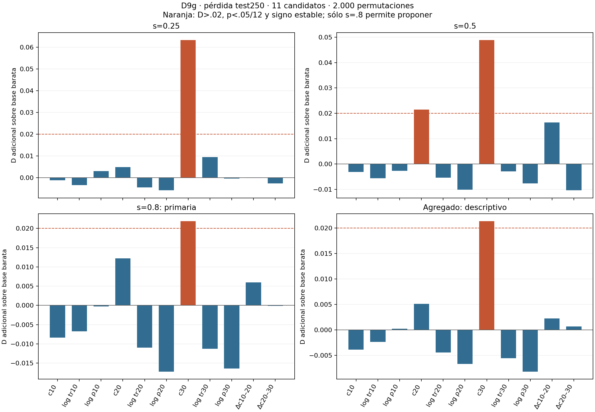

# DIN-D9g · colapso y generalización en mezclas gaussianas

**Exploratorio: PROPONER_CONFIRMATORIO_EXPLORATORIO para c(u30).**
En s=.8, c30 añade D=.021854 (p=.0009995<.05/12) sobre la base lineal de
pérdida train30, pérdida/precisión panel30 y X30; pendientes negativas en mitades
par/impar. Sólo mejora sobre esa base concreta. Sin base, c30 tiene D negativo.
El responsable decide el confirmatorio; **C2 no se usó y permanece reservada**.

[Conclusión completa](CONCLUSION.md) · [132 estimaciones y controles](results/run_v1/estimates.csv) ·
[análisis íntegro](results/run_v1/analysis.json) · [verificación PASS](verification.json).

[SVG](figures/incremento_geometria.svg).

Se estudiaron los 11 candidatos enumerados, con el umbral conservador .05/12,
como aprobó el responsable y corrigió el plan D9 en c5cea08. No se añadió Δc10→30.
Las diferencias10→20 y20→30 se ajustaron por la base barata del tiempo final.
Otros niveles y agregado se reportan descriptivamente; no rescatan ni deciden.

Se restauraron 7.500 checkpoints de 1.500 trayectorias G3, con error de reproducción
0. Nuevo test: 3.000 ejemplos/split, 1.000/clase, seeds711000..711099; escalado sólo
train archivado. No reentrenamiento, no nueva medición de rho. Originales intactos.
No se leyeron Wine, Iris, datos T2/DIN-C1 ni estados/tablas/checkpoints C2.

- [Diseño congelado](DESIGN_FROZEN.md) y [configuración](config.json).
- [Teoría y límites](THEORY.md), [reproducción](REPRODUCCION.md).
- [Tabla de trayectorias](results/run_v1/trajectories.csv), [visitas](results/run_v1/states.csv).
- [Entorno](results/run_v1/environment.json), [controles](results/run_v1/controls.json).
- [Inventario G3](input_manifest.csv), [manifiesto externo](external_manifest.csv).
- [Archivo reversible](record_manifest.csv), [shards](results/run_v1/record_shards/).
- [Fuentes congeladas](freeze_manifest.csv), [manifiesto completo](manifest.csv).

Los arrays de test/predicción/permutaciones y checkpoints originales están fuera
de Git en rutas locales con SHA. Se conserva todo; no se borran ni sustituyen estados.
No hubo fallos ni enmiendas de implementación. No se afirma causalidad, necesidad
del colapso, transferencia a datos reales ni resultado confirmatorio.
