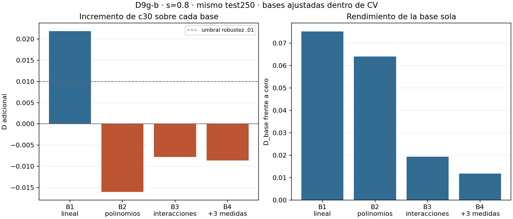

# DIN-D9g-b · robustez de c30 frente a bases baratas flexibles

**No robusto con B2–B4.** Regla congelada: **ARTEFACTO_DE_BASE_LINEAL_EXPLORATORIO**
porque B3 y B4 tienen D≤0 en s=.8. Es una etiqueta operacional, no una explicación
causal: las bases flexibles solas también predicen peor que B1 y muestran inestabilidad.
Recomendación al responsable: posponer el confirmatorio apoyado sólo en D9g.

| s=.8 | D adicional c30 | p exploratorio | D_base sola |
|---|---:|---:|---:|
|B1 lineal|.021854|.001000|.075126|
|B2 cuadrados/cubos|−.016018|.998501|.063988|
|B3 interacciones|−.007763|.862069|.019266|
|B4 + margen/entropía/norma|−.008598|.885557|.011801|

[Conclusión y límites](CONCLUSION.md) · [16 resultados completos](results/run_v1/estimates.csv) ·
[salida íntegra](results/run_v1/analysis.json) · [verificación PASS](verification.json).

[SVG](figures/robustez_bases.svg).

- [Diseño congelado](DESIGN_FROZEN.md), [configuración](config.json), [teoría](THEORY.md).
- [Reproducción](REPRODUCCION.md), [controles completos](results/run_v1/controls.json).
- [1.500 filas de covariables](results/run_v1/features.csv), [detalles](results/run_v1/feature_details.json).
- [Fuentes D9g por commit/SHA](sources/provenance.json), [inputs G3](input_manifest.csv).
- [Manifiesto externo](external_manifest.csv), [manifest de entrega](manifest.csv), [congelación](freeze_manifest.csv).

El test250 es exactamente el publicado en D9g (seeds711000..711099), copiado sin
regenerar ni reevaluar. Sólo se derivaron margen firmado panel, entropía panel y
norma de pesos en u30; parámetros de transformaciones ajustados por bloque train.
B1 reproduce D9g con p idéntica. Positivos, negativos y contraste OLS pasan.
B5 se excluyó antes del código. No se añadió ninguna base tras mirar resultados.

C2 permanece reservada, sin acceso a sus datos. No se modificó D9g ni otra etapa;
no se usaron Wine/Iris/T2/DIN-C1. Sin afirmación confirmatoria, causal o transferencia.
No hubo fallos de medición/análisis. Se preserva un fallo sintáctico de borrador de
presentación y su [enmienda previa](ENMIENDA_REPORTE_v1_CONGELADA.md), sin efecto
sobre datos, código científico, criterio o resultados. Arrays fuera de Git con SHA.
