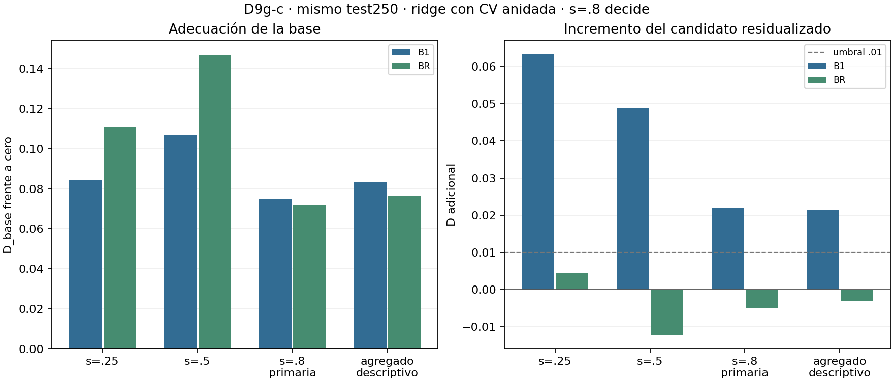

# DIN-D9g-c — base flexible regularizada

**REDUNDANTE_EXPLORATORIO** en s=.8 según la regla congelada: proponer Q13 al
responsable. C2 permanece reservada y no se ejecuta aquí el siguiente estudio.

| Modelo, s=.8 | D_base | D adicional de c30 | p |
|---|---:|---:|---:|
| B1 lineal, referencia | .075126 | .021854 | .001 |
| BR ridge anidado, base de lectura | .071646 | −.004952 | .653 |

BR pierde .003479 frente a B1, dentro del margen prefijado .005; por eso decide
BR. No mejora sobre B1. El candidato es **c30 residualizada por OLS sobre los
21 términos baratos en entrenamiento, añadida sin penalizar**, por decisión
del responsable antes de congelar. «Redundante» es una lectura predictiva bajo
este estimando; no demuestra identidad algebraica ni ausencia exacta de efecto.

Se reutilizaron las 1.500 filas archivadas de D9g/D9g-b por SHA, sin generar test,
reentrenar, reevaluar redes o medir geometría. CV externa de 10 bloques por split,
interna de 5, 33 valores de λ y 999 permutaciones que repiten el pipeline completo.
Controles negativos, positivos grande/pequeño y contraste numérico: PASS. El
positivo pequeño es una realización detectada, no una estimación de potencia.

- [Conclusión y límites](CONCLUSION.md) · [diseño congelado](DESIGN_FROZEN.md).
- [Decisión del candidato](DECISION_CANDIDATO.md) · [teoría](THEORY.md).
- [Estimaciones](results/run_v1/estimates.csv) · [controles](results/run_v1/controls.json).
- [Verificación](verification.json) · [reproducción](REPRODUCCION.md).
- [Fuentes por SHA](sources/provenance.json) · [manifiesto](manifest.csv).
- [Arrays externos por SHA](external_manifest.csv): se conservan fuera de Git.
- [Avance final](progress_02.md): cronología y ausencia de enmiendas.

