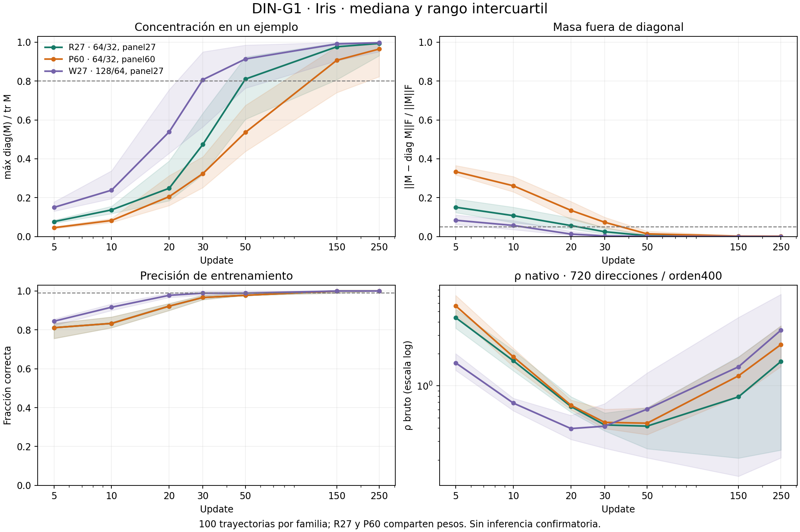

# DIN-G1 · el colapso fuera de Wine

**Sí aparece el mecanismo de concentración sobre el ejemplo difícil fuera
de Wine: H1 cumple el criterio estricto en Iris con la red más ancha. No se
transfiere uniformemente el paquete completo H1–H5.** En R27 y P60 el
colapso queda indeterminado por la regla prefijada; H2 aparece en los estados
colapsados de las tres familias. No aparece una señal temprana positiva
consistente de H5. Todos los resultados son exploratorios.

La inferencia sobre rho tiene además un límite real del instrumento:
el suplemento angular encontró un rayo más corto que un retorno nativo.
Se informa separado de los veredictos operacionales congelados, sin sustituir
resultados ni cambiar reglas después de medir.

## Cohorte y variables controladas

20 splits×5 inicializaciones POR familia,100 trayectorias,700 estados cada una.
Iris de sklearn,3 clases,4 variables. Train90/pool60, StandardScaler ajustado
sólo en train. f son las dos primeras variables estandarizadas. Adam lr.006,
lote64,250 updates sin parada temprana; visitas5,10,20,30,50,150,250.

| Familia | Red | Panel | Único cambio frente a R27 |
|---|---|---:|---|
|R27 |4→64→32→3 |27 |Referencia externa: Iris y entrada adaptada frente al antecedente Wine |
|P60 |4→64→32→3 |60 |Añadir33 ejemplos prefijados al mismo panel/base de validación |
|W27 |4→128→64→3 |27 |Anchos de ambas capas ocultas |

R27/P60 comparten EXACTAMENTE los100 entrenamientos y pesos por visita.
W27 añade100:200 entrenamientos físicos,300 trayectorias por familia en total.
No son300 entrenamientos independientes. Los20 splits tampoco son20 datasets
independientes: reutilizan las150 observaciones de Iris.

## Tabla de veredictos por las reglas congeladas

| Familia | H1 diagonalidad+colapso | H2 dominante=difícil | H3 asociación rho | H4 sincronía | H5 incremento temprano |
|---|---|---|---|---|---|
|R27 |INDETERMINADO |APARECE |APARECE |INDETERMINADO |NO_APARECE |
|P60 |INDETERMINADO |APARECE |INDETERMINADO |APARECE |INDETERMINADO |
|W27 |APARECE |APARECE |APARECE |INDETERMINADO |INDETERMINADO |

[Reglas previas](DESIGN_FROZEN.md) · [tabla CSV](results/run_v1/hypotheses.csv) ·
[resumen completo](results/run_v1/summary.json).
H3/H5 son resultados del instrumento nativo y los controles de calidad
previstos; no un certificado del mínimo matemático de semirrectas.

## H1 y H2 · forma e identidad del dominante

Colapsado=c≥.8 y q≤.05, con c=maxdiag/tr y q=fracción Frobenius fuera de diagonal.
Se exigía≥80% colapsados en150/250 y aumento≥.5 respecto a5.

| Familia | Colapsados tardíos /200 | Fracción | Colapsados u250 /100 | Mediana c250 | Mediana q250 | H2 en tardíos colapsados |
|---|---:|---:|---:|---:|---:|---:|
|R27 |158 |79.0% |83 |.99342 |.0002298 |158/158 |
|P60 |143 |71.5% |78 |.96484 |.0018265 |143/143 |
|W27 |178 |89.0% |88 |.99722 |.0001235 |178/178 |

En5 no hubo ningún estado colapsado. R27 queda JUSTO por debajo del80%
registrado: no se baja el umbral para promover79% a APARECE. Una mediana
casi1 tampoco implica que todas las trayectorias colapsen.
H2 cubre20/19/19 splits respectivamente; se aceptan empates según diseño.
Sin condicionar al colapso, en250 k* coincide con el menos confiado en100/100
trayectorias de cada familia. Esto no demuestra una identidad universal de M.

## H3 · relación con probabilidad de la etiqueta verdadera

En los tardíos colapsados con rho válida:

| Familia | n | Spearman agrupada | W intra-split en250 | Splits de W | Auditorías rho /40 |
|---|---:|---:|---:|---:|---:|
|R27 |158 |.99736 |.93333 |18 |39 aprobadas |
|P60 |143 |.97693 |.67500 |16 |37 aprobadas |
|W27 |178 |.99261 |.90000 |18 |40 aprobadas |

Las asociaciones de P60 satisfacen los umbrales descriptivos, pero su
auditoría no llega a38/40 (95%): **H3 permanece INDETERMINADO**. No se mezclan
las familias para salvar una compuerta fallida. Las120 auditorías se
completaron;116 aprobaron. Los4 fallos son todos de u10:
R27_s15 y P60_s02/s12/s13, k0, con diferencias máximas1.54% y2.88%.
[Todos los contrastes](results/run_v1/audits.csv).

## H4 · tiempo del colapso y de memorizar

Se usan primeras visitas que cumplen el criterio y lo mantienen hasta250;
la ausencia se conserva como censura derecha. No son fechas continuas exactas.

| Familia | Ambos eventos | A distancia≤1 visita | Fracción | Sin memoria mantenida /100 | Sin colapso mantenido /100 |
|---|---:|---:|---:|---:|---:|
|R27 |82 |62 |75.61% |1 |17 |
|P60 |78 |70 |89.74% |1 |22 |
|W27 |88 |58 |65.91% |0 |12 |

Sólo P60 supera80%. R27/W27 quedan en la banda intermedia, no se presentan
como falta demostrada de relación. La memoria mantenida aparece
principalmente en150/250 para R27/P60; W27 concentra su colapso mantenido en
20–50 y su memoria en una ventana más amplia. No se reproduce uniformemente
la ventana Wine10–30 ni se establece causalidad.
[Eventos y censura](results/run_v1/events.csv).

## H5 · no se reproduce una ganancia temprana positiva consistente

Todos los modelos tienen el par10/250,100 por familia y20 splits. En10 no
estaban colapsados100%,100% y98%, respectivamente. D compara una base cúbica
de log rho10 con esa base más X10, fuera de5 folds de splits. No tiene p-valor.

| Familia | D total | Beta X | D pares | D impares | W_adj legado | Lectura congelada |
|---|---:|---:|---:|---:|---:|---|
|R27 |-.01779 |-1.2780 |-.06351 |-.04012 |-.120 |NO_APARECE |
|P60 |-.02095 |-.4211 |-.01006 |-.04650 |-.145 |INDETERMINADO por auditoría rho |
|W27 |-.01553 |-.0234 |+.05725 |-.02213 |+.135 |INDETERMINADO por desacuerdo entre mitades |

Un W_adj positivo de W27 no rescata un D negativo ni identifica información
condicional nueva. No se cambia u10 por otra visita ni se seleccionan splits.
El NO_APARECE de R27 es descriptivo bajo este modelo/presupuesto, no una
prueba de ausencia de toda señal temprana en Iris.

## Forma colapsada no implica contracción sostenida de la escala

rho bruto bajó inicialmente y volvió a subir. Al final, el dominante estaba
mal clasificado en75%,93% y76% de las trayectorias R27/P60/W27. Su probabilidad
de etiqueta verdadera mediana fue.01421,.001760 y.003116. Eso mide confianza
en la etiqueta verdadera; no se identifica automáticamente con entropía
predictiva ni se afirma haberla medido.

| Familia | Mediana trM en5→250 | Mediana rho nativa mínima por visita →250 | Mediana rho/sqrt(trM)250 |1/n |
|---|---:|---:|---:|---:|
|R27 |689.96→2091.01 |.41774(u50)→1.69541 |.03706695 |.03703704 |
|P60 |2577.84→20788.07 |.44519(u50)→2.44430 |.01673947 |.01666667 |
|W27 |427.02→8162.69 |.39621(u20)→3.33826 |.03704551 |.03703704 |

La forma normalizada se aproxima al piso coordenado, mientras crece la
escala asociada al ejemplo difícil. Esto difiere de la contracción de escala
descrita en Wine. La pérdida mediana train250 fue.00240,.00240,.000482;
la de validación.17850,.17511,.23489, con precisión mediana.96296,.95000,.96296.
No se atribuye ese contraste a una causa única ni se dice que sea universal.
[Descriptivos completos](results/run_v1/additional_descriptives.csv).

## Identidad algebraica frente a hallazgo empírico

La construcción original, sin cambios, es M=R(F+gammaI)⁻¹Rᵀ. D2b establece
la aproximación n diag(odds) bajo rango interpolante y ridge despreciable;
no fuerza colapso de odds, momento de aparición o ganancia predictiva futura.
Aquí no se certificó ese régimen global: los rangos Fisher numéricos medianos
en250 fueron40.5/54,83/120 y36/54; gamma afecta modos débiles.

Sí se observó aproximación coordenada tardía: mediana de
rho/[sqrt(Mkk)/n] en250=1.00528,1.02298,1.00104. El leverage dominante
Mkk/[n odds_k] fue.99486,.63659,.99311. No se debe sustituir Mkk por n odds
sin esa condición: P60 muestra una diferencia relevante. Las caras más
grandes contienen4 índices, menores que n/2, lo que permite el factor1/n
del caso estrictamente coordenado de D2. No prueba un piso universal de M.

La novedad empírica es la aparición/frecuencia del colapso en estas redes,
su dependencia del panel/ancho y la evolución de los ejemplos difíciles.
La asociación de H3 se interpreta a la luz de esa construcción; no como
evidencia independiente de una ley causal nueva.
[Teoría y límites de rango](THEORY.md).

## Suplemento angular: límite demostrado del retorno nativo

Fue diseñado y comprometido DESPUÉS de observar una discrepancia de
resolución, antes de su código. Selección posterior explícita: el caso
motivante P60_s02_k0_u010 y tres centinelas R27/P60/W27_s00_k0_u010.
No se estima prevalencia ni se modifica el protocolo principal.
[Diseño separado](SUPLEMENTO_ANGULAR_FROZEN.md).

En el caso motivante, rho nativa720/400=**3.22644174096**. Para el rayo
exacto u=(-1,0), la integral por fases más error de quad y cola estimada da
**2.19202783022**: el retorno nativo es47.19% mayor que ese rayo. El error estimado de
quad fue≈2.6e-14 y la cola≈3.1e-13; la desigualdad tiene margen numérico grande.
La resolución1440/800 había devuelto3.26098245036: aumentar esa resolución
tampoco resolvió aquí el mínimo angular. No es un certificado de intervalos.

Esto proporciona un TESTIGO_NUMERICO de que ese retorno no es el mínimo
entre curvas concretas, aun con cuerda completa válida. Los otros tres
centinelas no dieron testigo axial; eso NO certifica su óptimo global.
[Retornos y errores](results/run_v1/angular_diagnostic/summary.json).

No se reemplaza ningún dato de H1–H5, no se reinterpreta el testigo como
un resultado preespecificado ni se modifica rho_borde.py. H1/H2/H4 se basan
en matrices/eventos y siguen separados de esta limitación. H3/H5 conservan
su etiqueta operacional, con cautela adicional al hablar de rho mínimo
matemático. Antes de extender afirmaciones de mínimos geométricos conviene
un protocolo nuevo de validación angular, con versiones archivadas.

## Límites y conservación

- Un dataset externo, dos anchos y dos paneles no establecen universalidad.
  Veinte particiones reusan las mismas plantas; las inicializaciones y las
  familias de panel están emparejadas.
- R27 cambia dataset, cardinalidad y entrada4 frente a13 de Wine. No es una
  intervención aislada sobre «dataset» manteniendo toda la geometría idéntica.
- P60 conserva pesos/lotes, pero n modifica a(0), promedio Fisher, composición
  del panel y factor1/n. W27 cambia también condición Fisher y parametrización.
- 250 updates no equivalen al mismo número de épocas que en otro dataset.
  No se alarga la trayectoria después de mirar un fallo ni se decide que un
  evento censurado haya ocurrido en250. El ajuste H5 es una clase cúbica
  concreta, no información condicional general y no una réplica confirmatoria.
- rho se midió720/400 con120 auditorías1440/800; esa resolución difiere del
  antecedente y la consistencia no certifica mínimo global. Se conservan4
  fallos de auditoría y el testigo angular posterior, sin corregirlos.

200 entrenamientos,2100 estados y120 auditorías completos, sin fallos de
ejecución ni matrices/rhos individuales fuera de sus controles básicos.
Tiempo principal2846.61s, dos procesos/BLAS1.3521 NPZ propios fuera de Git,
con matrices, pesos, momentos Adam, RNG, dataset/particiones y espectros.
[Recursos](results/run_v1/resources.json) · [inventario externo](external_manifest.csv).

Diseño bb7fedf → código28c6395 → entrenamientos/mediciones; análisis b96b277.
Suplemento congelado6512ffb → código0ace87b → diagnóstico después del cierre
principal. Los resúmenes adicionales no cambian veredictos. Ningún instrumento
ni etapa previa se modificó. No se cargó Wine ni dato T2/DIN-C1; sólo informes
publicados como contexto. La verificación reconstruye tres M desde nuestros
pesos Iris sin entrenar ni repetir rho.

La figura muestra medianas/IQR, no intervalos de confianza. R27/P60 comparten
la curva de entrenamiento. [SVG exportable](figures/trayectorias.svg).
