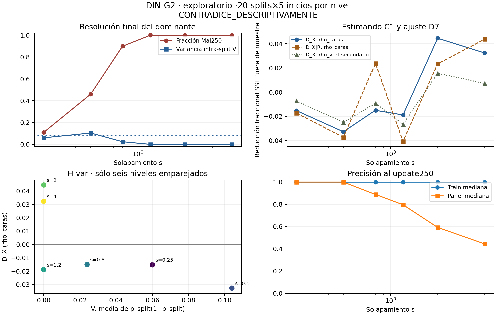

# DIN-G2 · conclusión exploratoria

**H-var: CONTRADICE_DESCRIPTIVAMENTE.** La cohorte cumple la regla de patrón inverso. No establece una ausencia universal de señal ni contradice las identidades de M.

Los datos son exclusivamente mezclas gaussianas sintéticas. Se conservaron
600 trayectorias planificadas y4200 visitas; visitas inválidas: **0**.
La lectura de Wine/DIN-C1/D7/G1 se limitó a informes agregados y código
permitido. No se cargó Wine, Iris ni datos T2/DIN-C1; no cambia ningún
estado anterior. Primaria rho_caras; rho_vert secundaria, sin rescatar la primaria.

## Resultados por nivel

| s | Mal250 | V intra-split | D_X | beta X | D_X condicionado a R | fracción retirada | p exploratorio | D_X vert secundario |
|---:|---:|---:|---:|---:|---:|---:|---:|---:|
|0.25|0.1100|0.0600|-0.0153|0.3952|-0.0173|—|0.441|-0.0072|
|0.5|0.4600|0.1040|-0.0327|-0.0837|-0.0373|—|0.805|-0.0249|
|0.8|0.9000|0.0240|-0.0150|-0.3139|0.0237|—|0.453|-0.0092|
|1.2|1.0000|0.0000|-0.0188|-0.7989|-0.0407|—|0.442|-0.0265|
|2|1.0000|0.0000|0.0445|1.3771|0.0233|0.4759|0.055|0.0156|
|4|1.0000|0.0000|0.0324|1.2133|0.0437|-0.3497|0.072|0.0072|

Mal es la clasificación errónea del dominante final k*=argmax diag M.
V es la media de p_split(1−p_split) con cinco inicializaciones por split;
máximo empírico.24. No mide la resolución del mismo individuo entre inicios:
la identidad del dominante puede cambiar. Las p usan999 permutaciones y son
**exclusivamente exploratorias**: no deciden el veredicto ni confirman nada.

## Aplicación de la regla previa

- Spearman entre los seis D y V: **-0.6375**.
- Manipulación suficiente: **True**; niveles altos: [1], bajos: [2, 3, 4, 5] (índices0–5).
- Ganadores de D: [4]; ganadores que cumplen máximo interior y V alta: [].
- Media D(alta V)−media D(baja V): **-0.0435**.
- Motivo adicional: Se aplican exactamente los umbrales congelados, sin usar p para decidir..

Apoyo exigía correlación≥.6, máximo interior con D≥.02 y beta positiva
cerca del máximo V, y diferencia media≥.02. Contradicción exigía el patrón
inverso definido en el diseño. Una ausencia de p significativa no se convierte
en contradicción; un secundario favorable tampoco rescata la primaria.

## Calidad y régimen de entrenamiento

| s | pares válidos | compuerta | mediana maxdiag/tr | mediana q | mediana acc train250 | mediana acc panel250 | frecuencia modal k* intra-split |
|---:|---:|---|---:|---:|---:|---:|---:|
|0.25|100|VALIDA|0.6057|0.0007|1.0000|1.0000|0.6400|
|0.5|100|VALIDA|0.7407|0.0001|1.0000|1.0000|0.6500|
|0.8|100|VALIDA|0.8657|0.0001|1.0000|0.8889|0.7600|
|1.2|100|VALIDA|0.6228|0.0207|1.0000|0.7963|0.7500|
|2|100|VALIDA|0.3241|0.1637|1.0000|0.5926|0.6400|
|4|100|VALIDA|0.2535|0.2004|1.0000|0.4444|0.5000|

D_X es el estimando C1 original: base cúbica centrada intra-split, diez
bloques de splits, semillas260010/260001. Se reutilizan sus funciones
sin ejecutar el CLI ni leer su cohorte. D_X|R añade Rc linealmente a la
misma base y conserva los bloques. R se mide en250: es descomposición
descriptiva, no predictor disponible en10 ni mediador causal identificado.
La fracción retirada sólo se define si D_X>.01 y no se recorta a[0,1].

## Identidad algebraica frente a evidencia

M=R_grad(F+gamma I)⁻¹R_gradᵀ es identidad de construcción; el factor
(1−p_y) de los gradientes también. La aproximación n·diag(odds) requiere
rango interpolante y ridge despreciable; no obliga al colapso ni a una
señal temporal. Los patrones de D y V de esta cohorte son evidencia empírica
exploratoria, no una consecuencia demostrada de esa identidad.

## Lectura del patrón y límite del mecanismo

La variación fue suficiente para activar la regla: en s=.5, Mal=.46 y
V=.104, pero D_X=−.0327. En s=2 y4, el dominante terminó mal clasificado
en100/100 trayectorias y V=0; aun así D_X fue+.0445 y+.0324. Esto contradice
el patrón binario H-var según el diseño, sin usar p para decidir.

Los dos incrementos positivos tienen p exploratorios.055 y.072: **no se
presentan como efectos confirmados**. Además sus medianas maxdiag/tr son
.324 y.254, frente a.866 en s=.8. La concentración cambia con el ruido:
este contraste no aísla una versión de H-var condicionada a colapso
coordenado comparable. No se filtran retrospectivamente trayectorias por c
para cambiar el veredicto. Esa condición requeriría un protocolo nuevo.

En s=2, añadir R deja D_X|R=.0233 y la fracción descriptiva es.4759;
en s=4 el ajuste condicionado sube a.0437 y la fracción es−.3497.
La razón compara incrementos con baselines/SSE diferentes: no es una
partición literal de varianza ni una fracción causal mediada. Que Mal sea
constante tampoco hace constante la confianza continua R o la forma de M.
En rho_vert secundario los incrementos positivos son menores (.0156/.0072),
sin promoverlo a primaria ni rescatar una hipótesis a posteriori.

## Conservación y controles

Verificación: **PASS**. Controles de triángulo, cara26,
generador y reproducción independiente de D/p en cuatro tablas sintéticas
aprobados. Las tres reconstrucciones prefijadas de M desde pesos tienen
error relativo cero; no se reentrenó ni se volvió a medir rho para ello.
Archivos externos verificados por SHA: 12740;
incluyen4200 checkpoints,4200 matrices/score arrays,4200 diagnósticos rho
completos y140 archivos base/particiones. Se conservan todos los fallos,
errores de cuadratura/restos y snapshots; no se sobrescriben archivos.
Tiempo de cohorte: 1114.62s, dos procesos CPU/BLAS1.
Diseño538120b → código7e6c715 → controles/entrenamientos/mediciones.
Fuente I2 r3 SHA2ac015a2, geometry b4d1e0e4 y core b5251d2f intactas.

## Límites y siguiente paso

Sólo seis niveles con20 réplicas sintéticas y cinco inicios; los niveles
comparten ruido/pesos/lotes. La correlación entre seis agregados es inestable
y no constituye una confirmación independiente. El ruido modifica Fisher,
gradientes y generalización simultáneamente: no aísla un mecanismo causal.
La clasificación binaria no agota la variación de confianza continua R.
D compara una base cúbica concreta, no toda función de L; centrar Y requiere
las medias de los splits completos. rho es una estimación sin certificado
de óptimo global ni intervalos. No se afirma transferencia a datos reales.
Un siguiente estudio necesitaría réplicas nuevas y diseño previo: no elegir
niveles, arquitectura o visita usando este mismo conjunto como confirmación.

[Diseño](DESIGN_FROZEN.md) · [teoría](THEORY.md) · [análisis íntegro](results/run_v1/analysis.json) ·
[tabla6 niveles](results/run_v1/levels.csv) · [tabla600 trayectorias](results/run_v1/trajectories.csv) ·
[tabla4200 visitas](results/run_v1/states.csv) · [variancias por split](results/run_v1/split_variance.csv) ·
[fallos](results/run_v1/failures.json) · [verification](verification.json) · [manifest](manifest.csv).

[SVG exportable](figures/resolucion.svg). Agregados descriptivos, sin intervalos de confianza.
