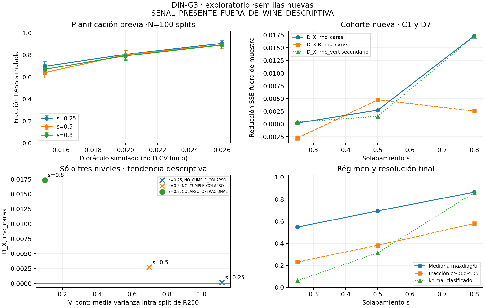

# DIN-G3 · conclusión exploratoria

**SENAL_PRESENTE_FUERA_DE_WINE_DESCRIPTIVA**.
Al menos un nivel con colapso operacional cumple la primaria. Es una señal exploratoria en este sintético; no transferencia a datos reales ni confirmación de DIN-C1.

Se completó el universo previsto de1500 trayectorias y10500 visitas; inválidas:0.
100 splits nuevos×5 inicios por nivel, s=.25/.5/.8. Primaria rho_caras de I2 r3 intacto.
Los niveles se eligieron mirando G2, declarado antes del código. Las semillas y
observaciones de cohorte son nuevas; G2 sólo fue piloto de planificación.

## Respuesta a las dos preguntas

**Señal temprana: sí, descriptivamente en s=.8.** X10 reduce el SSE fuera
de muestra un1.735% respecto a la base cúbica de log rho_caras10 (D=.017348,
p exploratorio=.003,beta=1.373). Los otros dos niveles son NOT_MET; no se
concluye que sus efectos sean exactamente cero. El efecto observado es menor
que.026, el tamaño de planificación. Hubo tres análisis sin corrección por
multiplicidad, por lo que este resultado no se llama confirmatorio.

**Dependencia de V_cont: no establecida.** Entre estos tres puntos, D aumenta
mientras V_cont disminuye (Spearman−1), pero sólo s=.8 cumple el criterio
operacional de colapso. Faltan varios niveles igualmente colapsados para
separar esa tendencia del cambio de régimen. No se afirma que mayor varianza
continua cause o sea requisito de la señal, ni que la tendencia inversa sea
una ley. V_cont es dispersión marginal; D_X|R es un incremento ajustado distinto.

En s=.8, mediana c=.8642 y mediana q=.000104 cumplen la regla de nivel;
**290/500 (58%)** cumplen individualmente c≥.8,q≤.05. El PASS se calcula
sobre las500 trayectorias, sin seleccionar esas290: no demuestra por separado
un efecto en ese subconjunto ni que todas las redes estén colapsadas.

Al añadir R250, D baja de.017348 a.002544; la razón descriptiva retirada es
.85335, sin interpretación causal ni partición literal de varianza. rho_vert
secundario coincide en la lectura (D=.017272,p=.0055); W_adj legado es.069 (p=.085), otro estimando que no sustituye la primaria.

## Potencia fijada antes de entrenar

| s | potencia .015 | potencia .020 | potencia .026 | Wilson inferior95% .026 | falsos PASS nulo |
|---:|---:|---:|---:|---:|---:|
|0.25|0.6975|0.8050|0.9050|0.8723|0.0300|
|0.50|0.6400|0.8025|0.8925|0.8583|0.0175|
|0.80|0.6700|0.7925|0.8900|0.8555|0.0250|

400 réplicas/nivel/efecto,1999 permutaciones C1 por réplica; cuatro
soportes bootstrap del piloto,100 ruidos Gaussianos cada uno. Primer tamaño
válido:100 splits. Se exigió límite inferior Wilson≥.8 para.026 y límite
superior del nulo≤.10 en los tres niveles. Los tamaños mayores no se probaron.
La equivalencia FWL/C1 pasó en cuatro tablas con p idéntica y errorD≤1e-10.
D_obj es oráculo bajo el modelo; elD CV medio finito se publica por separado.
**Potencia condicional a ruido Gaussiano y soporte piloto**, no garantía
universal ni intervalo de un efecto de la cohorte observada.

## Primaria y régimen por nivel

| s | pares | D | p exploratorio | beta X | veredicto | mediana c250 | mediana q250 | régimen |
|---:|---:|---:|---:|---:|---|---:|---:|---|
|0.25|500|0.0002|0.1655|0.3098|NOT_MET|0.5473|0.0009|NO_CUMPLE_COLAPSO|
|0.50|500|0.0027|0.0895|0.5359|NOT_MET|0.6943|0.0003|NO_CUMPLE_COLAPSO|
|0.80|500|0.0173|0.0030|1.3732|PASS_DESCRIPTIVO|0.8642|0.0001|COLAPSO_OPERACIONAL|

PASS_DESCRIPTIVO requiere p<.05,D>0,beta>0, con compuerta válida. Colapso
operacional requiere mediana c≥.8 y mediana q≤.05. No se filtran individuos
por colapso para cambiar el ajuste ni se presupone el régimen por s.
Se reutilizan cen,D_cv,primaria de C1 sin cambios: base cúbica, centrado
intra-split,10 bloques/260010,1999 permutaciones dentro del split/260001.
La primaria mejora a esa base concreta, no a toda función de log rho10.

Niveles elegibles para colapso:[2]; PASS primarios:[2];
PASS en colapso:[2] (índices0–2).
La lectura de ausencia exige todos NOT_MET, pares completos y potencia
simulada suficiente, y sigue sin ser una prueba de equivalencia.

## Resolución continua y clasificación binaria secundaria

| s | V_cont | V_bin | k* mal250 | fracción individual colapsada | acc panel250 mediana | frecuencia modal k* |
|---:|---:|---:|---:|---:|---:|---:|
|0.25|1.115638|0.0312|0.0620|0.2300|1.0000|0.6200|
|0.50|0.698187|0.0872|0.3140|0.3820|1.0000|0.7200|
|0.80|0.099995|0.0528|0.8600|0.5800|0.9259|0.7680|

V_cont=media de varianzas poblacionales de los cinco R250 por split;
R=log(1−p_y(k*(250))). La clasificación puede ser constante y la confianza
variar. La identidad k* puede cambiar; no es un individuo común preseleccionado.
Spearman entre D yV_cont: **-1.0000**, sólo TRES niveles.
No hay p de esa tendencia ni contraste de dependencia causal; se informa
qué niveles cumplen colapso para evitar mezclar regímenes sin advertirlo.

## Secundarios prefijados

| s | D_X condicionado R | fracción descriptiva retirada | D vert | p vert exploratorio | veredicto vert | W_adj legado | p legado exploratorio |
|---:|---:|---:|---:|---:|---|---:|---:|
|0.25|-0.0028|—|0.0004|0.1655|NOT_MET|0.0720|0.0775|
|0.50|0.0048|—|0.0015|0.1200|NOT_MET|0.0510|0.1465|
|0.80|0.0025|0.8534|0.0173|0.0055|PASS_DESCRIPTIVO|0.0690|0.0850|

D7 añade Rc lineal a la misma base y conserva los diez bloques; R se mide
en250 y no está disponible en10. La razón1−Dcond/D sólo existe siD>.01,
sin recorte, y compara bases/SSE diferentes: no es fracción causal mediada.
W_adj es LEGADO (residuo Y lineal sobre L y rangos conX): no prueba nueva
información condicional y no rescata un NOT_MET, según el contraejemplo D2b.

## Identidad algebraica y límites

M=R_grad(F+gamma I)⁻¹R_gradᵀ y el factor residual1−p_y son identidades
del instrumento. La aproximación n·diag(odds) exige rango interpolante
y ridge despreciable; no obliga a colapso ni a una señal temporal.
D,V_cont y los veredictos de la cohorte son hallazgos empíricos, no identidades.
La planificación reutiliza G2 para elegir niveles/escala, no como cohorte G3.
Hay tres análisis exploratorios y una tendencia de tres puntos; incluso un
PASS con semillas nuevas no se llama confirmatorio. Sin transferencia a
Wine/Iris/datos reales, causalidad, certificado de mínimo de rho o intervalos.
El centrado Y del estimando usa las medias de splits completos; no es por
sí solo un predictor operativo con medias finales desconocidas.

## Controles, conservación y cronología

verification.json: **PASS**;10500 registros,1500 trayectorias,
31912 archivos externos conSHA. Fuentes intactas; sólo G3 modificado.
Controles triángulo/cara26,r3,generador,C1 y semillas disjuntas PASS.
Tres reconstrucciones M desde pesos prefijadas: error relativo0,f idéntica,
sin reentrenar ni repetir rho. Se conservan fallos y outputs desconocidos.
Metadatos originales en shardsJSONL reversibles; arrays, pesos, RNG/Adam,
diagnósticos rho y simulaciones de potencia fuera de Git conSHA.
Tiempo cohorte:2849.66s, dos procesos CPU/BLAS1.
Diseño7bce1dc → código potencia3f01bc7 → potencia → tamaño1e88d2b →
código cohorte2048dd4 → controles/entrenamientos/mediciones. No cambian
el cierre de C1 ni G1/G2 ni instrumentos congelados.

[Diseño](DESIGN_FROZEN.md) · [tamaño](SAMPLE_FROZEN.md) · [potencia](results/power_v1/power_table.csv) ·
[análisis completo](results/run_v1/analysis.json) · [niveles](results/run_v1/levels.csv) ·
[trayectorias](results/run_v1/trajectories.csv) · [visitas](results/run_v1/states.csv) ·
[verificación](verification.json) · [manifest](manifest.csv).

[SVG exportable](figures/potencia_senal.svg).
