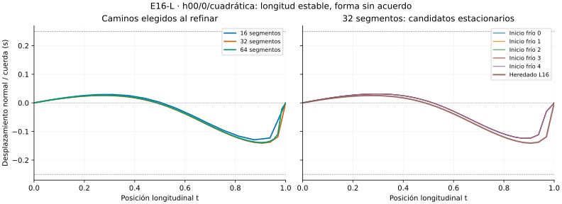

# Conclusión E16-L — La longitud se estabiliza antes que la forma

El único caso pendiente K, h00/0/cuadrática, **cumple en L el criterio original
de longitud 0,001**, pero no los criterios nuevos y congelados de forma y
estabilidad entre reinicios. Por ello **L permanece INCONCLUSIVE**, con el
control de suma PASS_NUMERICAL. K no cambia su estado histórico.

| Comparación del camino elegido | Error de longitud normalizado | Separación máxima normal / cuerda |
|---|---:|---:|
| 16→32 segmentos | 0,0003531106 | 0,05737013 (5,737 %) |
| 32→64 segmentos | 0,0001205699 | 0,03818503 (3,819 %) |
| Umbral fijado | 0,001 en ambos | 0,005 y 0,001, respectivamente |

La longitud normaliza por max(1,|L_a|,|L_b|); no es un porcentaje relativo cuando
L<1. La comparación de forma usa el mismo parámetro longitudinal: es el máximo
de diferencias normales entre poligonales, dividido por la cuerda. No es una
distancia intrínseca ni Hausdorff entre curvas arbitrarias.

## Longitudes y forma

Las longitudes elegidas son:

| Segmentos | Longitud | Estado de la resolución |
|---|---:|---|
| 16 | 0,5075772923 | PASS_NUMERICAL |
| 32 | 0,5072241817 | INCONCLUSIVE por desacuerdo entre reinicios |
| 64 | 0,5071036118 | PASS_NUMERICAL |

Las mallas contienen exactamente los caminos anteriores por prolongación; se
validó la conservación de longitud y el no-empeoramiento de recta/heredado.
La mejora total frente a K16 es descriptiva, ≈0,09332 %. No basta para declarar
que la forma completa convergió según los umbrales fijados.

La figura sólo usa coordenadas guardadas, sin otra optimización. Las diferencias
se aprecian especialmente cerca del extremo t=1; esta observación visual no
identifica por sí sola una causa geométrica ni demuestra una singularidad.

## Diferencias entre reinicios en 32 segmentos

Los cinco inicios fríos terminan cerca de L=0,5075026885. El inicio heredado
desde L16 obtiene L=0,5072241817. El rango normalizado es 0,0002785068, mayor
que 0,00001 permitido; la máxima separación de parámetros es 0,08819595,
mayor que 0,001 permitido. Se conservan todas las salidas, no sólo la más corta.

Los 36 reinicios, incluidos esos seis, pasan objetivo/gradiente, residual KKT y
positividad. Son **candidatos estacionarios discretos distintos** en esa malla;
no se atribuye su diferencia a un error de gradiente detectado. No se calcularon
Hessianas en L ni se prueban múltiples mínimos, unicidad o geodésicas continuas.

En 64 segmentos los seis reinicios sí coinciden dentro de las tolerancias de
longitud y forma, pero eso no borra el desacuerdo en 32 ni el cambio de forma
entre mallas. Ningún candidato elegido alcanza frontera: las diferencias no
se explican aquí mediante activación del límite de la caja.

## Qué pasó y qué no

Se validan 36/36 reinicios, cinco de seis resoluciones y el control de suma.
Pasan 2712 controles y quedan cuatro INCONCLUSIVE: longitud entre reinicios M32,
forma entre reinicios M32 y las dos comparaciones de forma entre mallas.
No hay FAIL. Todos los criterios de refinamiento de longitud pasan.

El máximo error normalizado autograd/MP80 fue 2,53e-14 y el desacuerdo entre
pasos MP 9,44e-34. El mayor residual KKT fue 1,72e-6 frente a 1e-5 permitido.
Las diferencias finitas locales se contrastaron con el objetivo completo en las
coordenadas extremas fijadas del candidato M16. No se cambiaron las funciones K.

Se guardan 452 registros de tramos a 80/120 cifras, gradientes por coordenada y
188 diferencias de forma por nodo. Todas las salidas y recorridos elegidos pasaron
SPD numérica, sin certificados mediante intervalos dirigidos. La primera corrida
consumió 19,39 s y 70,32 MiB, dentro de 300 s/512 MiB.
Diseño congelado en `0212bcf`; primera evidencia preservada en `48d09f7`.

## Interpretación y límites

El anterior límite de longitud ya no bloquea el resultado; **el camino completo
no alcanza el acuerdo fijado**. Comparar sólo números de longitud habría omitido
esta diferencia. No se añadieron mallas, reinicios ni tolerancias retrospectivas
para convertir el resultado global en PASS.

La fase es diagnóstica sobre un caso conocido y un control, sin entrenamiento
ni evaluación predictiva. No demuestra una ley general RIPG, mínimo global,
geodésica continua o convergencia matemática al continuo. El acuerdo fallido de
forma se refiere a la comparación declarada, no descarta que otra noción de
distancia entre curvas produzca un diagnóstico distinto.

Antes de refinar otra vez de forma uniforme, conviene un protocolo que siga
las ramas estacionarias por prolongación y examine dónde se concentra el cambio
de forma. Cualquier diagnóstico adicional debe congelarse antes de ejecutarse.
L y K conservan sus estados originales; T2-A y evidencia anterior permanecen intactos.
