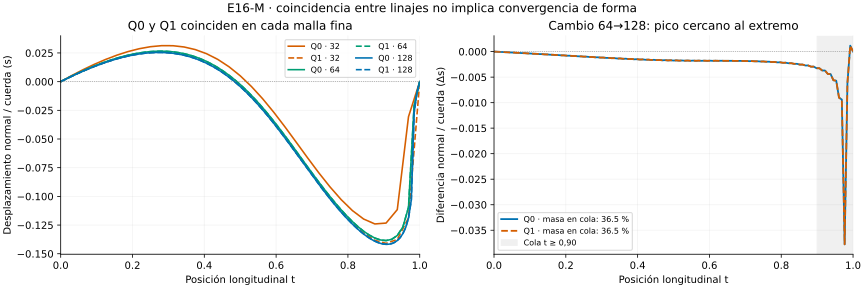

# Conclusión E16-M — Coincidencia entre candidatos sin estabilidad de forma

**INCONCLUSIVE global.** Q0 y Q1, procedentes de candidatos L32 distintos,
coinciden numéricamente en cada malla 64 y 128 al prolongarlos por separado.
Sin embargo, las cuatro transiciones cuadráticas incumplen el criterio de forma.
El control C0 pasa; los nueve recorridos y seis optimizaciones cumplen sus
controles instrumentales. L conserva su estado original.

## Identidad de los candidatos

El agrupamiento previo usa longitud≤1e-5 y forma≤1e-3 respecto a todos los
miembros del grupo, ordenados por índice. Q0 representa el inicio L32 número 0
(grupo de cinco inicios fríos); Q1 el número 5 (heredado); C0 el control suma.
No se elige el más corto ni se cambian etiquetas después de refinar.

| Malla | Diferencia de longitud Q0/Q1 normalizada | Separación de forma / cuerda | Diagnóstico |
|---|---:|---:|---|
| 32 | 0,0002785068 | 0,08819513 | Candidatos distintos |
| 64 | 2,39e-13 | 7,16e-7 | Acuerdo numérico |
| 128 | 5,50e-14 | 8,16e-7 | Acuerdo numérico |

Este acuerdo no prueba unicidad o una bifurcación. Se siguió el origen de las
inicializaciones, no una continuación matemática certificada: el optimizador
puede cambiar de cuenca al variar la discretización.

## Cambio al refinar

| Linaje y refinamiento | Error de longitud | Diferencia máxima de forma / cuerda |
|---|---:|---:|
| Q0: 32→64 | 0,0003990767 | 0,07895040 |
| Q1: 32→64 | 0,0001205699 | 0,03818557 |
| Q0: 64→128 | 0,0000745057 | 0,03775826 |
| Q1: 64→128 | 0,0000745057 | 0,03775783 |

Todas las longitudes cumplen 0,001; las formas no cumplen 0,001. El acuerdo de
los dos linajes en la misma malla no implica que el camino sea estable entre
mallas. La forma se compara al mismo t y normaliza por la cuerda: no es distancia
intrínseca, Hausdorff ni error demostrado respecto a una solución continua.
C0 conserva el camino recto y diferencia de forma cero en ambas transiciones.

## Pico cerca del extremo no equivale a concentración total

Los máximos de cambio de forma están en t≈0,969–0,984. Aun así, ninguna transición
cuadrática cumple la definición congelada LOCALIZED_AT_END: al menos la mitad
de la masa integrada |Δs| en t≥0,90, y máximo exterior≤25% del máximo global.

Para Q1, 64→128, la fracción de masa es:

| Zona final | Fracción de ∫|Δs|dt |
|---|---:|
| t≥0,75 | 54,16 % |
| t≥0,90 | 36,49 % |
| t≥0,95 | 26,19 % |

El máximo fuera de t≥0,90 es sólo 8,63% del pico, pero una diferencia pequeña
extendida sobre buena parte del camino aporta masa integrada. El pico está
cerca del extremo; **no se estableció que la mayoría del cambio esté en el
último 10%**. La integral por tramos incluye cruces de signo y pasó controles
analíticos. Ninguna de estas medidas demuestra singularidad, dinámica causal
ni una capa límite de una ecuación continua.

La localización de diferencias Q0/Q1 en mallas finas, ya por debajo de tolerancia,
es sólo un descriptor numérico; no se interpreta como efecto físico resuelto.

## Evidencia instrumental y corrección del lector

Pasan 7492 controles; cuatro quedan INCONCLUSIVE, todos de forma. No hay FAIL.
Se conservan 1344 registros de tramos, 663 parámetros y 663 gradientes, además
de diferencias por nodo y localización en tres colas prefijadas.
Los nueve recorridos pasan objetivo, gradiente, KKT, primitiva, cuadratura,
reparametrización, precisión 80/120 y SPD numérica. El máximo error autograd/MP80
fue 3,93e-14, y el mayor residual KKT 1,59e-6. No hay frontera activa.

La primera corrida v1 (`1486ef1`) produjo también un inconcluso artificial del
control al tratar un decimal de 40 cifras significativas como exacto. Se conserva
con su código y salidas. La [errata](ERRATA_IMPLEMENTACION_v1.md), congelada antes
de corregir, interpreta exclusivamente esa referencia como intervalo de redondeo;
los contrastes numéricos reales siguen usando las tolerancias originales.
V2 se preserva en `6eeaf8f`: siete tablas completas de geometría, gradientes,
tramos y comparaciones son idénticas byte a byte a v1. No se rescatan las formas.

V2 tomó 18,72 s y 72,70 MiB, dentro de 300 s/512 MiB. El diseño se congeló en
`eacfa4d`, la corrección de lectura en `456aa57` y su implementación en `4dfbcdc`.
No se añadieron mallas o reinicios según resultados.

## Alcance

M distingue acuerdo entre inicializaciones de acuerdo al refinar, y máximo local
de masa integrada. No establece geodésicas, mínimos globales, múltiples mínimos,
convergencia al continuo, capacidad predictiva ni una ley general RIPG.
La positividad no está certificada por intervalos. La fase es diagnóstica sobre
resultados conocidos; no se entrenó ninguna red.

El siguiente diseño debe investigar por qué persiste la diferencia de forma
cerca del extremo sin asumir una causa única: por ejemplo, contrastar otra
parametrización o distribución de nodos y conservar las soluciones de referencia.
No se ejecuta ese diagnóstico en M ni se redefine retrospectivamente su éxito.
L y T2-A permanecen intactos.
