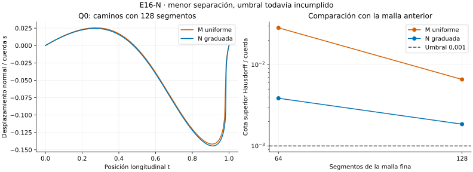

# E16-N — Nodos graduados y distancia entre curvas

**Resultado global: INCONCLUSIVE.** Concentrar nodos cerca del extremo reduce
la separación observada al refinar, pero no alcanza los umbrales fijados.
Cambiar la comparación a Hausdorff tampoco elimina la discrepancia.
Es un diagnóstico exploratorio sobre el mismo caso sintético de M.

- [Protocolo congelado](DESIGN_FROZEN.md), [configuración](config.json) y
  [nota de acotación previa a mediciones](IMPLEMENTATION_NOTE.md).
- [Conclusión y límites](CONCLUSION.md), [avance](progress.md).
- [Resultados íntegros de la primera corrida](results/run_v1/summary.json),
  [comparaciones Hausdorff](results/run_v1/hausdorff.csv),
  [transiciones](results/run_v1/transitions.csv).



## Qué se cambió

Se siguen Q0 y Q1 de [M](../M/README.md) y su control C0, sin descartar ninguno.
La malla anidada usa $t_i=1-(1-i/m)^2$, para $m=32,64,128$. Se mantienen
los extremos, el corredor transversal, la métrica y el objetivo de longitud.
La primera inicialización interpola M32: esto modifica el polígono, y sus
cambios se registran en [la tabla de referencias](results/run_v1/source_reference_intervals.csv).
Después cada refinamiento representa exactamente el polígono anterior antes
de volver a optimizar. N ejecuta nueve optimizaciones; M no se vuelve a ejecutar.

Además del máximo de $|s_1(t)-s_2(t)|$ al mismo $t$, se estima

$$d_H(A,B)=\max\left\{\sup_{a\in A}\inf_{b\in B}\|a-b\|_2,
\sup_{b\in B}\inf_{a\in A}\|b-a\|_2\right\}.$$

Se usa la carta $(t,s)$: equivale a distancia euclídea en perspectivas dividida
por la longitud de la cuerda. **No es la distancia intrínseca de la métrica RIPG.**
Las curvas incluyen el interior de cada segmento. Cotas inferiores por
puntos y superiores por Lipschitz/convexidad acotan Hausdorff hasta brecha
$10^{-5}$. El método usa float64, sin intervalos dirigidos; las cotas son
numéricas. No se afirma igualdad exacta cuando ambas cotas impresas coinciden.
Los controles cubren subdivisión, traslación paralela y un máximo interior
que una comparación sólo de vértices no detectaría.

## Resultados

Comparación 64→128, valores normalizados por la cuerda:

| Familia / linaje | Máximo al mismo t | Intervalo numérico de Hausdorff |
| --- | ---: | ---: |
| M / Q0 | 0,0377583 | ≈0,00657821 |
| M / Q1 | 0,0377578 | ≈0,00657809 |
| N / Q0 | 0,0287070 | [0,00185151; 0,00185281] |
| N / Q1 | 0,0287047 | [0,00185109; 0,00185234] |

El umbral fijado es 0,001. Las cotas **inferiores** de Hausdorff de ambos
linajes N ya lo superan; reducir la brecha del estimador no basta para pasar.
Los cambios de longitud N64→N128 son ≈0,0000188918 y sí pasan su umbral 0,001.
Q0 y Q1 coinciden entre sí en cada malla N según la regla heredada; esto no
implica estabilidad frente al refinamiento. El control suma permanece recto.

Nueve de nueve caminos pasan validación: gradiente, KKT, integración,
precisión 80/120 y positividad a lo largo de cada segmento. Hay 7511 checks:
7503 PASS, cero FAIL y ocho INCONCLUSIVE (cuatro de forma y cuatro Hausdorff).
No hay nodos en el borde del corredor. La primera corrida usa 21,07 s y
72,81 MiB; recursos separados de las tablas reproducibles.

## Reproducción

Con Python y dependencias de [requirements.txt](requirements.txt):

```bash
OPENBLAS_NUM_THREADS=1 OMP_NUM_THREADS=1 python experiments/E16/N/scripts/run.py --out /tmp/e16-n
OPENBLAS_NUM_THREADS=1 OMP_NUM_THREADS=1 python experiments/E16/N/scripts/verify.py
```

El verificador coteja los hashes, la congelación previa, el alcance de los
cambios, los controles geométricos, el anidamiento y las **14 salidas científicas
byte por byte** en una segunda ejecución. Los tiempos y la memoria se excluyen
del cotejo exacto. La figura usa sólo CSV guardados y dependencias opcionales de
[requirements-plot.txt](requirements-plot.txt):

```bash
python experiments/E16/N/scripts/plot_comparison.py
```

El acuerdo exacto observado corresponde al entorno registrado en
[provenance.json](results/run_v1/provenance.json); no garantiza identidad
entre versiones distintas de bibliotecas o plataformas. Los manifests sólo
abarcan N; no se regeneran los de etapas previas.
