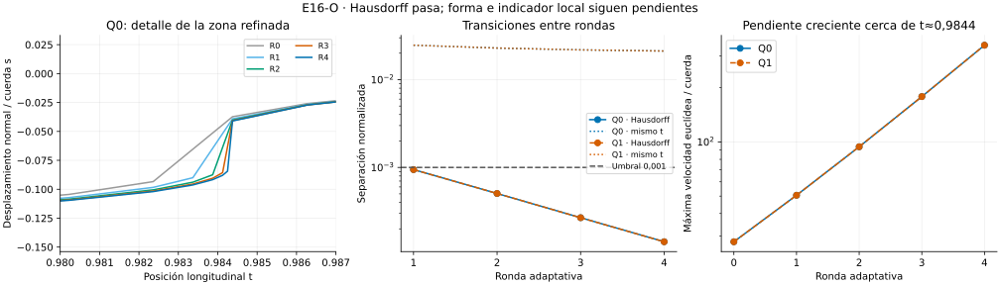

# E16-O — Refinamiento guiado por un indicador local

**Resultado global: INCONCLUSIVE.** Las ocho transiciones pasan longitud y
Hausdorff; ninguna pasa el máximo de cambio al mismo parámetro longitudinal.
El indicador terminal permanece sobre el umbral. Los once caminos y los 1428
probes locales pasan sus comprobaciones numéricas.

- [Protocolo congelado](DESIGN_FROZEN.md), [configuración](config.json) y
  [grupos heredados](groups.json).
- [Conclusión y límites](CONCLUSION.md), [registro](progress.md),
  [nota del lector de escalares](SERIALIZATION_NOTE.md).
- [Resumen completo](results/run_v1/summary.json),
  [transiciones](results/run_v1/transitions.csv),
  [marcado](results/run_v1/marking.csv), [probes](results/run_v1/probes.csv),
  [perfiles](results/run_v1/profiles.csv) y [colas](results/run_v1/tails.csv).



## Protocolo

Se parte de Q0, Q1 y C0 de [N128](../N/README.md), sin reoptimizar esa etapa.
No se cambian datos, métrica, extremos ni corredor transversal. Se conserva
la familia de gráficos poligonales

$$p(t)=a+t(b-a)+s(t)R(b-a),\qquad |s(t)|\leq0,25.$$

En cada segmento se explora un punto medio longitudinal nuevo con extremos
fijos. Se minimiza la longitud de sus dos mitades respecto al nuevo valor de s;
se comparan el candidato bounded, los límites y el valor interpolado original.
La exploración no garantiza un mínimo unidimensional global. Una mejora de
hasta $10^{-12}\max(1,L_{segmento})$ conserva el punto original.

Con desplazamiento $\eta_s$ y ganancia local $\eta_L$, el indicador es

$$E_j=\max\left(\frac{\eta_{s,j}}{10^{-3}},
\sqrt{\frac{\eta_{L,j}}{10^{-8}}}\right).$$

Se marca el prefijo mínimo por $E_j^2$ descendente que acumula 50 % del total,
con desempate por índice y máximo 32 bisecciones por ronda. Las nuevas
optimizaciones empiezan con el punto **interpolado original**, conservando el
polígono anterior. El valor explorado sólo informa el marcado. Cada linaje
adapta su propia malla; no se seleccionan candidatos por resultado.

Hay cuatro rondas como máximo, hasta 256 segmentos. El criterio terminal del
caso cuadrático requiere $\max E_j\leq1$ y dos transiciones consecutivas que
pasen longitud, forma, Hausdorff y validación de caminos. Este indicador es
heurístico: **no es una cota del error respecto a una curva límite**.

## Qué ocurrió

En ambos candidatos el marcado seleccionó un segmento por ronda, capturando
entre 51,2 % y 55,4 % del indicador cuadrático total. Se pasó de 128 a 132
segmentos. Se agotaron las cuatro rondas fijadas; no el límite de segmentos
ni los presupuestos de tiempo o memoria. C0 tuvo indicador cero y permaneció
recto, sin refinamientos ni reoptimización.

| Medida de Q0 | Primera transición 128→129 | Última transición 131→132 |
| --- | ---: | ---: |
| Cambio de longitud normalizado | 0,000004079 | 0,000000426 |
| Máximo de cambio al mismo t | 0,0246777 | 0,0211844 |
| Cota superior de Hausdorff / cuerda | 0,000945627 | 0,000142572 |

Q1 presenta valores cercanos; la [tabla completa](results/run_v1/transitions.csv)
conserva ambos. Longitud y Hausdorff cumplen 0,001 en las ocho transiciones.
El máximo al mismo t no cumple. El indicador máximo de Q0 evoluciona
18,84 → 17,36 → 18,15 → 18,67 → 19,04, lejos de ≤1. En la última ronda su
probe máximo propone desplazamiento ≈0,01904 y ganancia ≈2,04e-7.

La máxima velocidad euclídea por unidad de t, dividida por la cuerda, crece
27,88 → 50,54 → 93,99 → 178,55 → 344,56. La zona de máximo termina en
$t=0,984375$, un nodo heredado de N128; no es el extremo $t=1$. El intervalo
más empinado se estrecha hasta [0,984249115; 0,984375]. Esta coincidencia con
un nodo previo es un diagnóstico, no una causa demostrada.

La fracción de longitud de Q0 en $t\geq0,9$ cambia de ≈12,6445 % a ≈12,7084 %.
Un pico de pendiente no implica que toda la longitud o el cambio de forma se
concentren allí. La regla heredada de concentración de masa del cambio tampoco
declara localizadas las ocho transiciones. Q0/Q1 coinciden entre sí en las
cinco etapas, lo cual no sustituye la estabilidad de cada refinamiento.

## Validación y reproducción

Once de once caminos pasan gradiente AD frente a diferencias finitas locales
multiprecisión, KKT, precisión 80/120, cuadraturas, reparametrización y
positividad por segmento. Los 1428 probes pasan éxito del optimizador local y
comparación con la primitiva de 80 cifras. El máximo residual KKT es 2,67e-6;
no hay nodos activos en el borde del corredor.

Hay 18705 checks: 18697 PASS, cero FAIL y ocho INCONCLUSIVE, todos de forma.
La primera corrida usó 53,10 s y 81,38 MiB. Se conservan íntegros código,
resultados y formato original de escalares. [La nota de lectura](SERIALIZATION_NOTE.md)
explica el fallo inicial del verificador y su corrección, sin alterar la corrida.

Con Python y [requirements.txt](requirements.txt):

```bash
OPENBLAS_NUM_THREADS=1 OMP_NUM_THREADS=1 python experiments/E16/O/scripts/run.py --out /tmp/e16-o
OPENBLAS_NUM_THREADS=1 OMP_NUM_THREADS=1 python experiments/E16/O/scripts/verify.py
```

El verificador coteja las **17 salidas científicas byte por byte** en una
segunda ejecución, además del protocolo, hashes, fuente N128, marcado y
conservación de nodos. Recursos se informan aparte. La identidad exacta se
comprueba en el entorno de [provenance.json](results/run_v1/provenance.json),
sin garantizarla entre otras versiones o plataformas.

La figura lee únicamente CSV guardados, usando las dependencias opcionales de
[requirements-plot.txt](requirements-plot.txt):

```bash
python experiments/E16/O/scripts/plot_adaptive.py
```

Los resultados de N, M y todas las etapas previas permanecen intactos. No se
modifica ningún archivo de T2-A.
