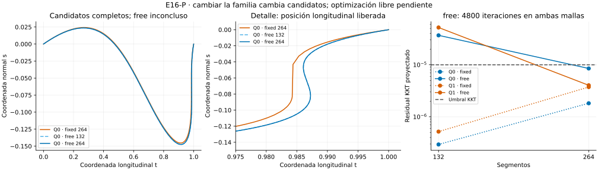

# E16-P — Gráficos frente a curvas paramétricas

**Resultado global: INCONCLUSIVE.** Liberar las posiciones longitudinales
produce candidatos diferentes, con retrocesos que una representación como
gráfico no admite. Sin embargo, las cuatro optimizaciones libres cuadráticas
agotan las 4800 iteraciones. No se declara resuelta la optimización ni la
convergencia geométrica.

- [Protocolo congelado](DESIGN_FROZEN.md), [configuración](config.json),
  [grupos heredados](groups.json), [conclusión y límites](CONCLUSION.md).
- [Resumen](results/run_v1/summary.json), [caminos y estados](results/run_v1/paths.csv),
  [refinamientos](results/run_v1/refinements.csv),
  [comparaciones](results/run_v1/comparisons.csv),
  [gradiente longitudinal de las fuentes](results/run_v1/release_gradients.csv).
- [Registro de ejecución](progress.md), [controles](results/run_v1/controls.csv).



## Pregunta y formulación

[O](../O/README.md) mostraba pendientes crecientes junto a un nodo heredado.
P pregunta qué cambia al permitir que ese nodo también se mueva longitudinalmente.
Se conserva la misma métrica h y la longitud

$$L[p]=\int_0^1\sqrt{\dot p(u)^T h(p(u))\dot p(u)}\,du,$$

con curvas poligonales

$$p(u)=a+t(u)(b-a)+s(u)R(b-a),\qquad
0\leq t(u)\leq1,\quad |s(u)|\leq0,25.$$

Extremos fijos: (t,s)=(0,0) y (1,0). En `fixed`, cada t_i permanece fijo y sólo
se optimiza s_i. En `free`, ambas coordenadas son variables: no se exige orden
en t, por lo que caben segmentos verticales y retrocesos. Es una ampliación de
la familia de caminos, no sólo otra velocidad para recorrer el mismo camino.
No se introduce penalización, regularización ni distancia mínima positiva
entre nodos. Una arista exactamente nula se rechaza como ensayo no evaluable;
en la corrida no se produjo ningún rechazo.

Ambas variantes parten independientemente del mismo camino: Q0/Q1 de O ronda
4, con 132 segmentos. C0 de O ronda 0 tiene 128 y se subdividen sus primeros
cuatro segmentos, conservando la recta, para igualar 132. Cada variante se
optimiza en 132 y después 264 segmentos, insertando los puntos medios de su
propio polígono antes de refinar. No hay reinicios ni selección del mejor caso.
La [tabla de referencias](results/run_v1/source_references.csv) verifica las
fuentes sin reejecutar O.

## Resultados

A 264 segmentos:

| Linaje / variante | Longitud | Residual KKT | Estado |
| --- | ---: | ---: | --- |
| Q0 / fixed | 0,506977917456 | 1,82e-6 | PASS_NUMERICAL |
| Q0 / free | 0,506972587514 | 8,50e-6 | INCONCLUSIVE |
| Q1 / fixed | 0,506977917454 | 3,73e-6 | PASS_NUMERICAL |
| Q1 / free | 0,506972595591 | 4,03e-6 | INCONCLUSIVE |

Los dos resultados `free` de 264 cumplen el umbral KKT 1e-5, pero el optimizador
agotó las iteraciones. El protocolo exige también terminación exitosa y dos
caminos válidos: no se cambia esa regla después de medir. En 132, los KKT libres
son 3,68e-5 y 5,21e-5, además de agotar las iteraciones.

Las longitudes fixed/free difieren sólo ≈5,3e-6, dentro del umbral descriptivo
1e-5. Aun así, Hausdorff entre ambas familias queda alrededor de **0,0035**, por
encima de 0,001: no coinciden geométricamente bajo la regla fijada. Son
candidatos de optimizaciones con distinto estado de terminación, no mínimos
certificados de ambas familias.

Al refinar 132→264, todos los pares cumplen longitud y Hausdorff. Las cotas
superiores Hausdorff de Q0 son ≈0,0002006 (`fixed`) y ≈0,00004470 (`free`);
las de Q1, ≈0,0001999 y ≈0,00009061. Los refinamientos libres siguen
INCONCLUSIVE por la validación de sus optimizadores. El acuerdo entre dos
mallas no demuestra convergencia de una sucesión.

Las fuentes de O tienen gradiente longitudinal máximo ≈0,0031166/0,0031168,
frente a gradientes transversales ≈2,66e-6/2,02e-7. Esto verifica que el pequeño
residual de O sólo describía sus variables disponibles. En la familia ampliada
quedaban direcciones sin optimizar; no hay contradicción con O.

En `free` aparecen tres aristas con retroceso en 132 y siete/ocho en 264.
El nodo heredado con t=0,984375 se mueve a ≈0,98632/0,98633 en 264. No queda
anclado al valor original. Ninguna arista cumple el criterio angular congelado
de casi vertical (|dt|/norma≤0,001); no se afirma haber encontrado un segmento
exactamente vertical. Q0/Q1 conservan acuerdo descriptivo entre sí, sin que eso
elimine las limitaciones de optimización. C0 sigue recto en ambas variantes.

## Validación y alcance

Ocho de doce caminos pasan el protocolo completo. Los doce pasan integración,
precisión 80/120, positividad por segmento y concordancia de gradientes AD/FD
multiprecisión. Los seis checks inconclusos son cuatro de terminación del
optimizador y dos de KKT. No hay FAIL. Se conservan todos los candidatos.

En total: seis combinaciones linaje/variante (cuatro pasan, dos inconclusas),
31069 checks (31063 PASS), seis refinamientos y diez comparaciones descriptivas.
Los controles cubren arista vertical, inversión, subdivisión, redistribución
por arco y Hausdorff. La primera corrida usa 98,51 s y 85,04 MiB, dentro de
600 s y 512 MiB. Los límites se fijaron antes de ejecutar.

Hausdorff se estima sobre polígonos completos en (t,s), con brecha≤1e-5.
Es euclídea en esta carta normalizada, no distancia intrínseca de h. Sus cotas
son numéricas en float64, sin intervalos dirigidos. El remuestreo por arco en
257 puntos es sólo un descriptor y no reemplaza ese estimador.

El PASS de `fixed` pertenece al protocolo P de longitud/Hausdorff. **No modifica
el INCONCLUSIVE de O**, que además exigía forma al mismo t e indicador terminal.
No se aplica sup|delta s(t)| a `free`, porque puede no ser un gráfico.

## Reproducción

Con Python y [requirements.txt](requirements.txt):

```bash
OPENBLAS_NUM_THREADS=1 OMP_NUM_THREADS=1 python experiments/E16/P/scripts/run.py --out /tmp/e16-p
OPENBLAS_NUM_THREADS=1 OMP_NUM_THREADS=1 python experiments/E16/P/scripts/verify.py
```

El verificador coteja las **13 salidas científicas byte por byte**, hashes,
congelación, coordenadas y familias, dominio, gradientes en las variables
correctas y rechazo explícito de aristas nulas. Recursos quedan aparte.
La identidad exacta se comprueba en el entorno registrado en
[provenance.json](results/run_v1/provenance.json), sin garantizarla entre
versiones distintas de bibliotecas o plataformas.

La figura se deriva sólo de CSV; sus dependencias opcionales están en
[requirements-plot.txt](requirements-plot.txt):

```bash
python experiments/E16/P/scripts/plot_contrast.py
```

O y las etapas anteriores permanecen intactos, al igual que todo T2-A.
