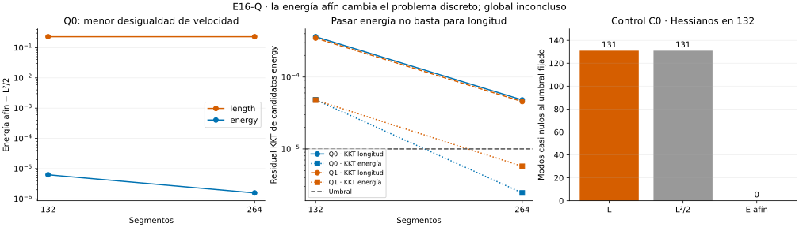

# E16-Q — Energía, parametrización y condicionamiento

**Resultado global de v2: INCONCLUSIVE.** La energía afín redistribuye los
nodos y reduce la desigualdad de velocidad, pero no resuelve la estacionariedad
de longitud de los casos cuadráticos. Los ocho candidatos cuadráticos agotan
las 4800 iteraciones. Los cuatro caminos del control C0 pasan.

- [Protocolo congelado](DESIGN_FROZEN.md), [configuración](config.json),
  [identidades y límites de equivalencia](THEORY.md).
- [Conclusión](CONCLUSION.md), [registro](progress.md),
  [errata conservada de v1](ERRATA_IMPLEMENTACION_v1.md).
- [Resumen v2](results/run_v2/summary.json), [caminos](results/run_v2/paths.csv),
  [energías y brechas](results/run_v2/energies.csv),
  [espectros](results/run_v2/spectra.csv),
  [comprobación direccional de Hessianos](results/run_v2/hessian_directions.csv).



## Qué se compara

Se mantienen Q0, Q1 y C0 de [P/free/132](../P/README.md), incluidos sus estados
inconclusos. Cada variante parte independientemente de esa misma fuente:
`length` minimiza L; `energy` minimiza la energía de segmentos afines con
intervalos de parámetro de duración 1/m. Ambas tienen t/s libres en el mismo
rectángulo y los mismos extremos. Se optimizan 132/264 segmentos, sin reinicios.
La continuación de referencia `length` pertenece a Q; no reescribe P.

La distinción fundamental es

$$E_{aff}=\frac m2\sum_i\int_0^1q_i(x)\,dx
\quad\ne\quad E_{arc}=\frac{L^2}{2}\quad\text{en general}.$$

E_arc corresponde al mismo camino recorrido con velocidad métrica constante;
E_aff obliga a recorrer cada segmento linealmente en tiempos iguales. Su
mínimo discreto puede cambiar. [La teoría](THEORY.md) deriva

$$E_{aff}\geq E_{dur}\geq E_{arc}=L^2/2,$$

incluyendo la energía mínima al variar sólo las duraciones de los segmentos.
Las tres magnitudes se registran, sin asumir equivalencia entre sus óptimos.

## Resultados v2

En los candidatos `energy` de 264 segmentos:

| Linaje | Longitud | Energía afín | KKT de energía | KKT de longitud |
| --- | ---: | ---: | ---: | ---: |
| Q0 | 0,506976267587 | 0,128514042684 | 2,44e-6 | 4,80e-5 |
| Q1 | 0,506976267606 | 0,128514042803 | 5,73e-6 | 4,56e-5 |

El umbral KKT es 1e-5. Ambos pasan el de energía, pero incumplen el de longitud
que el protocolo también exige. Además, el optimizador alcanza 4800 iteraciones
en los ocho casos cuadráticos, en ambas variantes y resoluciones. No se cambia
la regla de éxito por disponer de candidatos cercanos.

En Q0, la brecha E_aff−L²/2 del resultado `energy` baja de ≈6,27e-6 a ≈1,57e-6
al refinar. En `length` permanece alrededor de 0,229: minimizar longitud no
obliga a repartir uniformemente la velocidad respecto al parámetro u.
Reducir esa brecha tampoco sustituye el gradiente de longitud.

En 264, las variantes tienen acuerdo descriptivo de longitud/Hausdorff:
separación Hausdorff superior ≈9,51e-5 y ≈9,71e-5 para Q0/Q1. Eso no convierte
sus optimizaciones inconclusas en resultados estacionarios. Los seis pares de
refinamiento cumplen las tolerancias geométricas numéricas, pero sólo los dos
del control pasan el protocolo completo con ambos caminos válidos.

## Qué aporta el condicionamiento

Se evalúan nueve puntos en 132: fuente y ambos resultados de cada linaje,
sin filtrar por éxito. Para cada punto se guardan resúmenes de los tres
Hessianos y cuatro comprobaciones direccionales AD/MP.

- Se verifica H_arc=L·H_L+grad L·grad L^T. Un cambio escalar a L²/2 no elimina
  los modos nulos de longitud en estacionariedad.
- C0 tiene 131 modos casi nulos para L y E_arc y ninguno para E_aff, al umbral
  relativo congelado. El Hessiano de energía se coteja con la matriz analítica
  m·kron(T,G). Su razón espectral es ≈52486; eliminar modos nulos no elimina
  el condicionamiento dependiente de la malla.
- Las fuentes cuadráticas presentan Hessianos indefinidos de L y E_aff.
  No se llama número de condición SPD a la razón del espectro positivo cuando
  hay autovalores negativos o casi nulos.
- En los resultados `energy/132`, el Hessiano de E_aff es positivo al umbral,
  pero el de L tiene diez/ocho autovalores negativos. Son diagnósticos locales
  en puntos no estacionarios; no certifican mínimos ni puntos silla.

En C0, `length` conserva la distribución no uniforme de nodos y la misma
recta. `energy` llega a la distribución uniforme con error máximo en t≈7,14e-7,
normal dentro del umbral y error de energía frente a L_recta²/2≈7,6e-13.
Los controles de equivalencia y de redistribución tangencial pasan. Este caso
analítico no demuestra por sí solo la causa de la detención de Q0/Q1.

## Validación, fallo conservado y reproducción

V2 contiene doce caminos, de los cuales cuatro pasan el protocolo completo.
Los doce pasan integración de longitud/energía, precisión 80/120, positividad,
concordancia de ambos gradientes AD/MP y los controles de Hessianos aplicables.
Hay 36872 checks: 36856 PASS, cero FAIL y dieciséis INCONCLUSIVE, todos de
estacionariedad o terminación. No se rechazó ningún ensayo.

La primera implementación omitía el factor global m/2 en las diferencias
finitas locales de energía. La comprobación AD/MP detectó el fallo; se detuvo
v1 tras cuatro caminos. Se conservan [sus salidas parciales](results/run_v1/ABORTED.json),
el resumen original INCOMPLETE y el [snapshot](scripts/run_v1_snapshot.py).
[La errata](ERRATA_IMPLEMENTACION_v1.md) se congeló antes de corregir y ejecutar
v2. No cambió la optimización: coordenadas, objetivos e iteraciones de los cuatro
caminos comunes se cotejan exactamente. Las validaciones erróneas v1 no se
usan como evidencia geométrica ni se reemplazan retrospectivamente.

La corrida v2 usa 181,50 s y 93,31 MiB, dentro de los 900 s/512 MiB fijados.
Con Python y [requirements.txt](requirements.txt):

```bash
OPENBLAS_NUM_THREADS=1 OMP_NUM_THREADS=1 python experiments/E16/Q/scripts/run.py --out /tmp/e16-q
OPENBLAS_NUM_THREADS=1 OMP_NUM_THREADS=1 python experiments/E16/Q/scripts/verify.py
```

El verificador coteja las **15 salidas científicas v2 byte por byte** en una
segunda corrida. También verifica congelación, fuentes, v1 intacta, errata,
identidad de los candidatos comunes, objetivos y coordenadas. Recursos se
informan aparte. La identidad exacta corresponde al entorno de
[provenance.json](results/run_v2/provenance.json), no se garantiza entre
versiones o plataformas diferentes.

El manifest de implementación original corresponde a v1 y se verifica contra
su snapshot; [el de v2](implementation_manifest_v2.csv) corresponde al código
corregido. El manifest general sólo abarca Q, sin regenerar archivos anteriores.
La figura usa exclusivamente CSV v2; dependencias opcionales en
[requirements-plot.txt](requirements-plot.txt):

```bash
python experiments/E16/Q/scripts/plot_energy.py
```

P y todas las etapas previas conservan sus resultados. T2-A permanece intacto.
