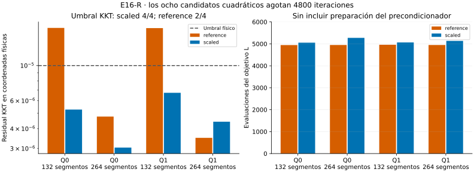

# E16-R — Precondicionamiento sin cambiar longitud

**Resultado global: INCONCLUSIVE.** El escalado cumple el KKT físico en los
cuatro candidatos cuadráticos, frente a dos de cuatro de la referencia. Sin
embargo, los ocho agotan 4800 iteraciones y el escalado consume más evaluaciones.
No se declara aceleración global ni se cambia el criterio de terminación.

- [Protocolo congelado](DESIGN_FROZEN.md), [configuración](config.json),
  [identidades del escalado y límites](THEORY.md).
- [Conclusión](CONCLUSION.md), [registro](progress.md),
  [resumen completo](results/run_v1/summary.json).
- [Caminos y residuos](results/run_v1/paths.csv), [costes](results/run_v1/costs.csv),
  [escalas](results/run_v1/scales.csv), [espectros](results/run_v1/spectra.csv),
  [comparaciones](results/run_v1/comparisons.csv).



## Contraste

Fuentes: Q0/Q1/C0 de [Q/length/132](../Q/README.md), incluidos sus estados
inconclusos. Dos métodos minimizan exactamente L en el mismo rectángulo,
con t/s libres y extremos fijos:

- `reference`: L-BFGS-B en coordenadas físicas x.
- `scaled`: L-BFGS-B en y, con x=Dy, cotas transformadas y objetivo L(Dy).

D es diagonal positivo, calculado una sola vez por linaje/malla a partir de
la diagonal del Hessiano de una referencia común. Sus factores son potencias
de dos entre 1/128 y 128. El piso y el valor absoluto usados para construir D
no alteran h ni L. No se añade energía, penalización o regularización.

En 132, ambos parten del mismo polígono. En 264, cada método subdivide su propio
resultado anterior; D sigue calculándose en la bisección de la fuente original
común. Por tanto, el contraste fino incluye la historia de continuación y no
permite atribuir toda diferencia únicamente a un cambio de coordenadas.
No hay reinicios ni selección retrospectiva de mejores candidatos.

## Resultados físicos y terminación

| Caso | KKT físico reference | KKT físico scaled | Evaluaciones reference / scaled |
| --- | ---: | ---: | ---: |
| Q0 / 132 | 1,73e-5 | 5,28e-6 | 4944 / 5054 |
| Q0 / 264 | 4,77e-6 | 3,04e-6 | 4949 / 5273 |
| Q1 / 132 | 1,72e-5 | 6,73e-6 | 4959 / 5064 |
| Q1 / 264 | 3,50e-6 | 4,43e-6 | 4949 / 5135 |

El umbral físico es 1e-5. El escalado mejora ambos casos de 132, pero no reduce
el residual de forma uniforme: en Q1/264 la referencia tiene el menor valor.
Todos los candidatos cuadráticos llegan a 4800 iteraciones. El protocolo
requiere además terminación exitosa, de modo que los ocho conservan
INCONCLUSIVE aunque seis cumplan KKT físico.

El residuo en y no es intercambiable con el físico. Por ejemplo, Q0/scaled/264
presenta residual del solver ≈1,28e-5 y físico ≈3,04e-6. Las condiciones KKT
exactas son equivalentes bajo el cambio de variables, pero una tolerancia
finita de gradiente cambia de escala. Por eso se validan las coordenadas
originales mediante AD y diferencias finitas MP80.

Los métodos tienen acuerdo descriptivo de longitud/Hausdorff en ambas mallas.
En 264 las cotas superiores Hausdorff entre métodos son ≈1,78e-5/1,76e-5.
Los seis pares de refinamiento cumplen las tolerancias geométricas, pero sólo
los dos de C0 pasan el protocolo completo. El control conserva su recta y
longitud en ambos métodos, sin exigir redistribución uniforme de nodos.

## Coste y condicionamiento

En los cuatro casos cuadráticos, el escalado usa 20526 evaluaciones de L frente
a 19801 de la referencia, además de cuatro Hessianos iniciales. Cada evaluación
de gradiente tiene el mismo conteo que la de función en esta corrida. El control
aporta dos búsquedas más por método, todas con cero iteraciones y una evaluación.

El presupuesto de iteraciones/funciones coincide, pero el coste total de los
métodos no es idéntico. [resources.json](results/run_v1/resources.json) separa
preparación del Hessiano/escalas, instrumentación espectral y optimización.
Los tiempos son medidas de este entorno, no un benchmark con incertidumbre
estimada. No se infiere ventaja temporal del escalado.

En las referencias comunes de 132, positivas al umbral espectral, la razón
espectral pasa de ≈3,53e8 a ≈1,56e7 en Q0 y de ≈2,13e8 a ≈2,10e7 en Q1.
Las referencias de 264, formadas por bisección sin optimizar, son indefinidas;
no se denomina condición SPD a la razón de su espectro positivo.

El control C0 requiere especial cautela: el Hessiano físico tiene los modos
nulos tangenciales esperados. Tras escalar la matriz AD en float64 aparecen
uno/dos autovalores negativos al umbral congelado y cambian los conteos cerca
de cero. El modelo exacto de la recta no adquiere curvatura negativa por una
congruencia positiva. [La teoría](THEORY.md) explica por qué esos números no
son prueba de curvatura negativa real; no se ajustó el umbral para ocultarlos.
No hay certificación rigurosa de autovalores ni de mínimos.

## Verificación y reproducción

Doce caminos pasan integración, precisión 80/120, positividad por segmento y
concordancia del gradiente físico AD/MP. Cuatro caminos C0 pasan el protocolo
completo; los ocho cuadráticos quedan inconclusos. Hay 31160 checks: 31150
PASS, cero FAIL y diez INCONCLUSIVE (ocho de terminación y dos de KKT físico).
No se rechazó ningún ensayo.

Se comprueban identidad de coordenadas, objetivo y cotas, regla de la cadena,
positividad de D, control cuadrático analítico y controles geométricos heredados.
La primera corrida usa 142,70 s y 94,21 MiB, dentro de 900 s/512 MiB congelados.

Con Python y [requirements.txt](requirements.txt):

```bash
OPENBLAS_NUM_THREADS=1 OMP_NUM_THREADS=1 python experiments/E16/R/scripts/run.py --out /tmp/e16-r
OPENBLAS_NUM_THREADS=1 OMP_NUM_THREADS=1 python experiments/E16/R/scripts/verify.py
```

El verificador coteja las **15 salidas científicas byte por byte**, reconstruye
las escalas y los dos residuos desde sus tablas, verifica costes, fuentes,
congelación y alcance. Los recursos se excluyen del cotejo exacto. El acuerdo
corresponde al entorno de [provenance.json](results/run_v1/provenance.json),
sin garantizar identidad entre versiones o plataformas diferentes.

La figura usa sólo CSV y las dependencias opcionales de
[requirements-plot.txt](requirements-plot.txt):

```bash
python experiments/E16/R/scripts/plot_scaling.py
```

La longitud y el dominio de Q no se reinterpretan ni se modifican. Todas las
etapas anteriores y todo T2-A permanecen intactos.
