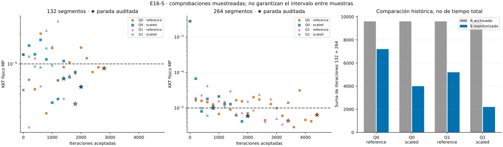

# E16-S — Parada por KKT físico auditado

Estado: **PASS_NUMERICAL** en los seis casos del protocolo, doce caminos y
seis refinamientos. Estudio exploratorio sintético, sin entrenamiento.

R agotaba iteraciones aun cuando algunos residuos físicos ya eran pequeños.
S congela otra regla antes de medir: auditoría AD/MP cada 200 iteraciones
aceptadas y parada en la tercera auditoría consecutiva con KKT físico ≤1e-5.
La evaluación inicial no cuenta. Se conservan L, cajas, fuentes Q, métodos y
presupuestos; se reutilizan las escalas diádicas archivadas de R.

- [Protocolo congelado](DESIGN_FROZEN.md), [configuración](config.json) y [grupos](groups.json).
- [Fundamento y alcance](THEORY.md), [conclusión](CONCLUSION.md) y [avances](progress.md).
- [Resumen original](results/run_v1/summary.json), [auditorías](results/run_v1/audits.csv), [caminos](results/run_v1/paths.csv), [refinamientos](results/run_v1/refinements.csv) y [costes](results/run_v1/costs.csv).
- [Comparación histórica con R](results/run_v1/historical.csv), cuyos estados originales permanecen intactos.

## Resultado

Ocho caminos cuadráticos terminan por PHYSICAL_SUSTAINED. SciPy devuelve
success=False y status=99 por StopIteration del callback: ambas banderas
se conservan, separadas del cumplimiento del protocolo. Cuatro controles C0
terminan naturalmente sin iteraciones (NATIVE_CONTROL).

| Camino | Iteraciones | Evaluaciones L | KKT físico final |
|---|---:|---:|---:|
| Q0/reference/132 | 2800 | 2892 | 9.04874e-06 |
| Q0/reference/264 | 4400 | 4531 | 6.44932e-06 |
| Q0/scaled/132 | 2000 | 2091 | 5.90408e-06 |
| Q0/scaled/264 | 2000 | 2179 | 5.93922e-06 |
| Q1/reference/132 | 1800 | 1859 | 3.99592e-06 |
| Q1/reference/264 | 3400 | 3503 | 4.38139e-06 |
| Q1/scaled/132 | 1400 | 1455 | 7.13015e-06 |
| Q1/scaled/264 | 800 | 861 | 9.94262e-06 |
| C0/reference/132 | 0 | 1 | 7.35612e-37 |
| C0/reference/264 | 0 | 1 | 2.94245e-36 |
| C0/scaled/132 | 0 | 1 | 7.35612e-37 |
| C0/scaled/264 | 0 | 1 | 2.94245e-36 |

Se registran 105 auditorías: 54 STATIONARY, 51 NONSTATIONARY y ninguna
UNVERIFIED. Las observaciones iniciales están incluidas en esos contadores.
Las 31.409 comprobaciones pasan. Los seis refinamientos pasan; en los cuatro
cuadráticos la cota superior numérica de Hausdorff está entre 4,59e-5 y
6,07e-5, con brecha ≤1e-5. Es distancia euclídea en coordenadas normalizadas,
sin redondeo dirigido, no distancia intrínseca certificada.



## Coste y límites

Primera corrida: 472,400 s y 90,496 MiB, dentro de 900 s/512 MiB.
Las auditorías consumen 362,629 s, incluida la inicial de cada camino.
Reducir iteraciones no implica ahorrar tiempo: R no tenía este monitor y
S reutiliza escalas ya calculadas. La continuación fina también cambia.
No se presenta la comparación histórica como benchmark temporal pareado.

La racha acredita tres muestras, sin garantizar el intervalo entre ellas ni
el futuro. AD y diferencias finitas MP son procedimientos distintos, no datos
independientes. KKT de primer orden no prueba mínimo, unicidad, geodésica ni
convergencia continua. R mantiene INCONCLUSIVE.

## Reproducción

Con las dependencias de [requirements.txt](requirements.txt), ejecutar desde
la raíz del repositorio, con un hilo BLAS:

```sh
OPENBLAS_NUM_THREADS=1 OMP_NUM_THREADS=1 python experiments/E16/S/scripts/run.py --out /tmp/e16-s
OPENBLAS_NUM_THREADS=1 OMP_NUM_THREADS=1 python experiments/E16/S/scripts/verify.py
```

Verificación completada: **PASS_REPRODUCTION**, dieciséis salidas idénticas
byte por byte; segunda corrida 486,203 s, dentro del presupuesto.

El verificador reconstruye las rachas desde CSV, contrasta hashes de los
estados, banderas, gradientes físicos, costes e historia R, y repite la corrida
para comparar exactamente dieciséis salidas científicas. Tiempos y memoria
quedan fuera de la igualdad. La figura lee únicamente resultados archivados;
sus dependencias están en [requirements-plot.txt](requirements-plot.txt).
