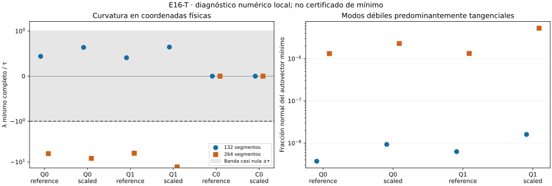

# E16-T — Segundo orden y modos de redistribución

Estado científico: **INCONCLUSIVE sobre mínimos**. Validación diagnóstica:
**PASS**, doce caminos y 488 comprobaciones aprobadas. No se optimiza ni se
modifica la aceptación de primer orden de S.

Los cuatro candidatos cuadráticos de 264 segmentos presentan curvatura
negativa numéricamente resuelta y contrastada por diferencias finitas MP.
Los cuatro de 132 tienen el autovalor mínimo dentro de la banda casi nula.
Los modos mínimos son casi enteramente tangenciales, pero mover nodos de
un polígono tangencialmente no es una reparametrización exacta.

- [Diseño congelado](DESIGN_FROZEN.md), [configuración y hashes](config.json).
- [Fórmulas y límites](THEORY.md), [conclusión](CONCLUSION.md), [avances](progress.md).
- [Resumen](results/run_v1/summary.json), [caminos](results/run_v1/paths.csv), [espectros escalares](results/run_v1/spectra.csv), [Rayleigh MP](results/run_v1/rayleigh.csv), [comprobaciones](results/run_v1/checks.csv) y [costes](results/run_v1/costs.csv).

## Resultado completo

Todos los Hessianos corresponden a L en coordenadas físicas normalizadas
(t,s), incluso si el candidato procede del método scaled de S. El umbral de
cada bloque es τ=1e-8 max(1,max|λ|), congelado antes de medir.

| Camino | λ mínimo completo | τ completo | λ mínimo normal | Fracción tangencial del modo mínimo |
|---|---:|---:|---:|---:|
| Q0/reference/132 | 1.665769e-06 | 3.7845e-06 | 0.0109821 | 0.9999999963 |
| Q0/reference/264 | -4.779845e-05 | 7.6462e-06 | 0.00547435 | 0.9999986794 |
| Q0/scaled/132 | 2.478307e-06 | 3.8827e-06 | 0.0108317 | 0.9999999907 |
| Q0/scaled/264 | -6.538997e-05 | 7.9795e-06 | 0.00539337 | 0.9999977038 |
| Q1/reference/132 | 1.571586e-06 | 3.8429e-06 | 0.0110209 | 0.9999999937 |
| Q1/reference/264 | -4.806938e-05 | 7.8548e-06 | 0.00549436 | 0.9999986645 |
| Q1/scaled/132 | 2.546538e-06 | 3.9456e-06 | 0.0108659 | 0.9999999840 |
| Q1/scaled/264 | -0.0001081283 | 8.1189e-06 | 0.00541625 | 0.9999947119 |
| C0/reference/132 | -8.531995e-12 | 0.0001746 | 0.073121 | 1.0000000000 |
| C0/reference/264 | -1.358617e-11 | 0.00065605 | 0.036562 | 1.0000000000 |
| C0/scaled/132 | -8.531995e-12 | 0.0001746 | 0.073121 | 1.0000000000 |
| C0/scaled/264 | -1.358617e-11 | 0.00065605 | 0.036562 | 1.0000000000 |

En los cuadráticos finos λ mínimo completo va de −4,78e-5 a −1,08e-4,
frente a τ de 7,65e-6 a 8,02e-6. Las direcciones mínimas y sus perturbaciones
son bilateralmente factibles; todos los caminos son interiores con margen
superior a 1e-8. Es una observación numérica de curvatura, sin control riguroso
de error ni afirmación de punto silla estacionario exacto.

Los bloques normales tienen espectro positivo al umbral en los doce caminos.
Eso no hace positivo al Hessiano completo ni construye un cociente geométrico:
existen acoplamientos entre los bloques. La participación tangencial del modo
mínimo supera 0,9999947 en los ocho cuadráticos. Se publican todos los espectros
escalares y cinco direcciones contrastadas por camino, sin matrices densas ni
autovectores internos.



## Controles y verificación

C0 conserva 131/263 modos casi nulos para 132/264 segmentos, de acuerdo con
su nulidad tangencial analítica. Sus mínimos negativos de orden 1e-11 quedan
muy dentro del umbral de 1,75e-4/6,56e-4 y no son evidencia de inestabilidad.
La comparación del Hessiano con la fórmula analítica pasa en los cuatro C0.

Se contrastan cinco Rayleigh por camino en MP80/MP120, con pasos 1e-10 y
1e-12. Máximo error AD/MP normalizado: 4,39e-12; entre pasos: 1,73e-18.
Las 120 filas Rayleigh y 9.456 autovalores escalares quedan archivados.
La validación de esas cinco direcciones no verifica todas las entradas del
Hessiano ni todos sus autovectores.

Primera corrida: 103,804 s y 68,105 MiB, dentro de 900 s/512 MiB.
No se repiten las auditorías cerradas de S: su KKT se reconstruye de las
columnas MP finales archivadas y se verifica identidad de fuentes y longitud.

## Reproducción

Instalar [requirements.txt](requirements.txt), desde la raíz:

```sh
OPENBLAS_NUM_THREADS=1 OMP_NUM_THREADS=1 python experiments/E16/T/scripts/run.py --out /tmp/e16-t
OPENBLAS_NUM_THREADS=1 OMP_NUM_THREADS=1 python experiments/E16/T/scripts/verify.py
```

**PASS_REPRODUCTION**: siete archivos científicos idénticos byte por byte;
segunda corrida 106,173 s, dentro del presupuesto.

El verificador reconstruye conteos espectrales, umbrales, identidades de bloques,
Rayleigh, costes y alcance; repite el cálculo y compara siete archivos
científicos byte por byte, excluyendo recursos. La figura usa sólo CSV y las
[dependencias gráficas](requirements-plot.txt).

No se deducen mínimos, unicidad o convergencia continua. El cambio entre mallas
es un límite del diagnóstico. Los datos son los mismos sintéticos de S,
sin independencia confirmatoria. S y todo T2-A permanecen intactos.
