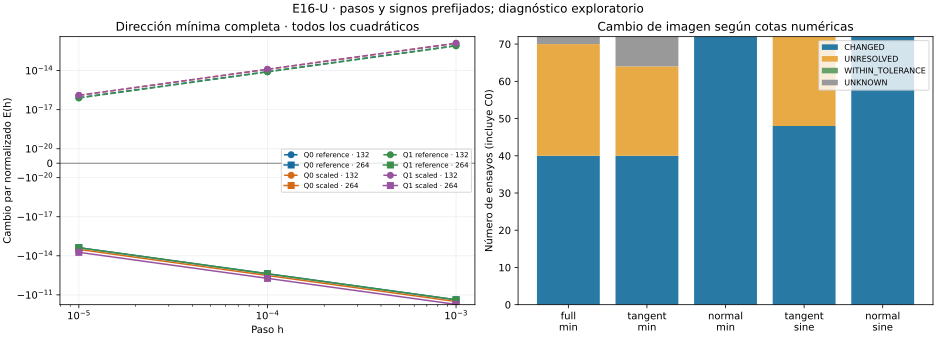

# E16-U — Descenso finito y cambio geométrico

Estado: **EXPLORATORY**, validez diagnóstica **PASS**. No se certifican mínimos.
Se conservan los doce candidatos de S y las cinco direcciones de T, con pasos
1e-5, 1e-4 y 1e-3 en ambos sentidos. No hay optimización, clipping, selección
de mejores puntos ni cambios en S/T.

Los cuatro cuadráticos de 264 segmentos tienen cambio simétrico negativo en
la dirección mínima para los tres pasos. En cada pareja un sentido desciende
y el otro aumenta. Los cuatro de 132 tienen cambio simétrico positivo en esa
dirección, aunque también presentan descensos unilaterales por gradiente residual.

- [Protocolo congelado](DESIGN_FROZEN.md), [configuración y fuentes](config.json).
- [Fórmulas y alcance](THEORY.md), [conclusión](CONCLUSION.md), [avances](progress.md).
- [Resumen](results/run_v1/summary.json), [todos los ensayos](results/run_v1/trials.csv), [parejas](results/run_v1/pairs.csv), [direcciones y hashes](results/run_v1/directions.csv), [comprobaciones](results/run_v1/checks.csv), [costes](results/run_v1/costs.csv) y [controles](results/run_v1/controls.csv).

## Todos los caminos

| Camino | Válidos / 30 | Inviables | Descensos | Geometrías CHANGED | Pasos con E<−1e-20 en full_min |
|---|---:|---:|---:|---:|---:|
| Q0/reference/132 | 30 | 0 | 11 | 30 | 0 |
| Q0/reference/264 | 30 | 0 | 11 | 26 | 3 |
| Q0/scaled/132 | 30 | 0 | 11 | 30 | 0 |
| Q0/scaled/264 | 30 | 0 | 12 | 26 | 3 |
| Q1/reference/132 | 30 | 0 | 11 | 30 | 0 |
| Q1/reference/264 | 30 | 0 | 11 | 26 | 3 |
| Q1/scaled/132 | 30 | 0 | 12 | 30 | 0 |
| Q1/scaled/264 | 30 | 0 | 11 | 26 | 3 |
| C0/reference/132 | 27 | 3 | 0 | 12 | 0 |
| C0/reference/264 | 28 | 2 | 0 | 12 | 0 |
| C0/scaled/132 | 27 | 3 | 0 | 12 | 0 |
| C0/scaled/264 | 28 | 2 | 0 | 12 | 0 |

De 360 ensayos, 350 son válidos, diez inviables por cajas y ninguno inválido.
Pasan las 1.487 comprobaciones. Hay 90 descensos unilaterales y 24 parejas
con cambio par negativo: doce full_min y doce tangent_min, todas en los
cuatro cuadráticos finos. Se conservan las parejas incompletas por inviabilidad.
No se usa el número de descensos como evidencia estadística independiente.

## Longitud frente a geometría

E=(Δ++Δ−)/2 separa el cambio par del componente impar asociado al gradiente.
En full_min fino, E está entre −2,39e-15 y −5,41e-15 para h=1e-5,
y entre −2,38e-11 y −5,40e-11 para h=1e-3. Son efectos pequeños; no se
presentan como una mejora práctica del optimizador ni como mínimos nuevos.
Los residuos respecto de la predicción cuadrática están archivados, sin
convertir la concordancia en una cota rigurosa del término omitido.

En los doce descensos full_min finos, la imagen queda UNRESOLVED para h=1e-5
y CHANGED para h=1e-4/1e-3. En estos últimos la cota inferior numérica supera
1e-8: no se trata de una reparametrización exacta de la misma poligonal.
Las cotas superiores por correspondencia son holgadas y no estiman Hausdorff
con precisión controlada. No se impone una brecha entre cotas en este protocolo.

Globalmente, 272 ensayos válidos son CHANGED y 78 UNRESOLVED; los diez
inviables tienen geometría UNKNOWN. Ninguno se clasifica WITHIN_TOLERANCE.
Una geometría UNRESOLVED no acredita identidad: incluso un segmento recto
con nodos redistribuidos puede tener una cota superior de correspondencia grande.
Todas las distancias son euclídeas en (t,s), sin redondeo dirigido ni métrica
intrínseca certificada.



## Controles y coste

Los controles C0 no presentan descensos: 58 cambios de longitud quedan dentro
de tolerancia, 52 aumentan y diez son inviables. La invariancia tangencial de
la recta requiere conservar el orden; una perturbación finita que lo invierte
puede aumentar longitud recorrida. C0 también incluye direcciones normales.
No se descartan esos resultados ni se ajustan pasos a sus márgenes pequeños.

MP80/MP120 concuerdan con máximo error relativo de 1,48e-80; positividad
métrica numérica comprobada en todas las aristas válidas por Bernstein heredado.
Las direcciones se reconstruyen con hashes idénticos a T; no se repite ni
modifica su auditoría. Los puntos perturbados son MP y la geometría se calcula
en sus proyecciones float64, con error de proyección controlado y colchón fijo.

Primera corrida: 211,519 s y 67,434 MiB, dentro de 900 s/512 MiB.
Matrices, autovectores y polígonos perturbados no se versionan; el código y
los hashes permiten reconstruirlos. Se guardan todos los resultados escalares.

## Reproducción

Con [requirements.txt](requirements.txt), desde la raíz:

```sh
OPENBLAS_NUM_THREADS=1 OMP_NUM_THREADS=1 python experiments/E16/U/scripts/run.py --out /tmp/e16-u
OPENBLAS_NUM_THREADS=1 OMP_NUM_THREADS=1 python experiments/E16/U/scripts/verify.py
```

**PASS_REPRODUCTION**: nueve salidas científicas idénticas byte por byte;
segunda corrida 216,954 s, dentro del presupuesto.

El verificador reconstruye parejas, signos, clasificación geométrica, costes,
fuentes y alcance, y repite para comparar nueve salidas científicas byte por
byte. Recursos quedan fuera de esa igualdad. La figura sólo lee CSV archivados;
usa [requirements-plot.txt](requirements-plot.txt).

No hay nuevos datos de confirmación ni prueba de mínimos o convergencia
continua. Los estados de S/T y todo T2-A permanecen intactos.
