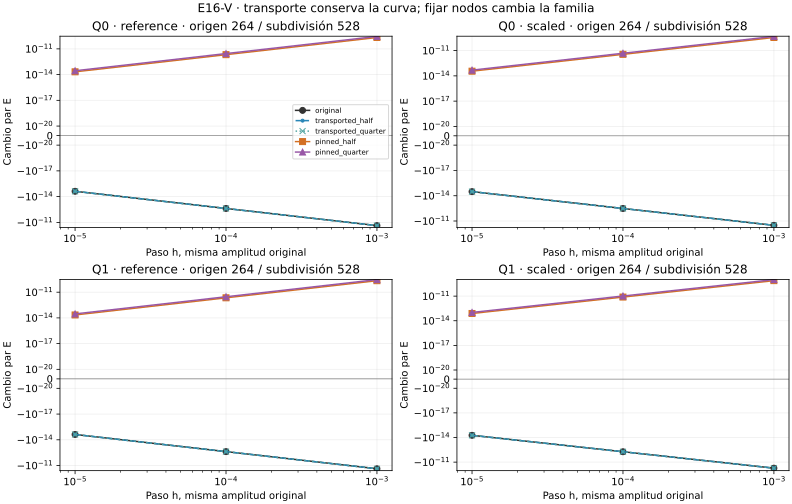

# E16-V — Transporte y nodos fijos bajo subdivisión

Estado **EXPLORATORY**, diagnóstico **PASS**: doce caminos, 360 ensayos,
350 válidos, diez inviables conservados y cero inválidos. Pasan las 2.466
comprobaciones. Mínimos permanecen UNKNOWN.

En los cuatro candidatos cuadráticos de 264 segmentos, el cambio par negativo
de U se conserva al transportar la perturbación a subdivisiones de 528,
tanto con inserciones en 1/2 como en 1/4 de cada arista. Al fijar los nodos
insertados, ese cambio par se vuelve positivo en los tres pasos medidos.
No desaparece el descenso unilateral: todavía desciende uno de los dos sentidos.

- [Diseño congelado](DESIGN_FROZEN.md), [configuración y fuentes](config.json).
- [Identidades y formulación](THEORY.md), [conclusión](CONCLUSION.md), [avances](progress.md).
- [Resumen](results/run_v1/summary.json), [todos los ensayos](results/run_v1/trials.csv), [parejas](results/run_v1/pairs.csv), [comparaciones](results/run_v1/comparisons.csv), [normas y hashes](results/run_v1/directions.csv), [comprobaciones](results/run_v1/checks.csv) y [costes](results/run_v1/costs.csv).

## Qué se compara

Se incluyen los doce caminos de S, full_min de T/U y pasos 1e-5/1e-4/1e-3 en
ambos sentidos, sin seleccionar resultados. En cada arista se inserta un punto
a fracción 1/2 o 1/4 desde su inicio. Ambas bases conservan imagen y longitud.
Las cinco familias son original, transported_half/quarter y pinned_half/quarter.

Transported mueve el nodo nuevo por interpolación de extremos perturbados:
es la misma curva perturbada, representada con más segmentos. Pinned mantiene
el nodo nuevo en su posición de la base y mueve sólo los vértices originales:
es otra familia de curvas. La prueba no vuelve a optimizar ni calcula el
Hessiano refinado completo. Los 264 segmentos obtenidos de un origen 132 no
son los candidatos optimizados 264 de S.

La amplitud en vértices originales es idéntica. No se renormalizan las
direcciones refinadas: la norma transportada está entre 1,290 y 1,414, mientras
la norma original y pinned es uno salvo redondeo. No se comparan Rayleigh como
si todas esas normas fueran iguales.

## Todos los caminos

| Camino de origen | Segmentos refinados | Válidos / 30 | Inviables | E negativo original / 3 | E negativo transportado / 6 | E negativo fijo / 6 |
|---|---:|---:|---:|---:|---:|---:|
| Q0/reference/132 | 264 | 30 | 0 | 0 | 0 | 0 |
| Q0/reference/264 | 528 | 30 | 0 | 3 | 6 | 0 |
| Q0/scaled/132 | 264 | 30 | 0 | 0 | 0 | 0 |
| Q0/scaled/264 | 528 | 30 | 0 | 3 | 6 | 0 |
| Q1/reference/132 | 264 | 30 | 0 | 0 | 0 | 0 |
| Q1/reference/264 | 528 | 30 | 0 | 3 | 6 | 0 |
| Q1/scaled/132 | 264 | 30 | 0 | 0 | 0 | 0 |
| Q1/scaled/264 | 528 | 30 | 0 | 3 | 6 | 0 |
| C0/reference/132 | 264 | 25 | 5 | 0 | 0 | 0 |
| C0/reference/264 | 528 | 30 | 0 | 0 | 0 | 0 |
| C0/scaled/132 | 264 | 25 | 5 | 0 | 0 | 0 |
| C0/scaled/264 | 528 | 30 | 0 | 0 | 0 | 0 |

Los valores E=(Δ++Δ−)/2 usan normalización max(1,|L original|) y banda ±1e-20.
Cada familia tiene 36 parejas: 34 completas y dos incompletas por inviabilidad.
Original y cada transported tienen doce E negativos, doce positivos y diez
dentro de tolerancia. Cada pinned tiene 26 positivos, ocho dentro de tolerancia
y ninguno negativo. Todas las parejas cuadráticas pinned son positivas.

En los cuatro orígenes finos, para h=1e-3, E transportado va de −2,38e-11 a
−5,40e-11; pinned_half de 2,10e-10 a 7,72e-10; pinned_quarter de 2,81e-10
a 1,04e-9. Los efectos siguen siendo pequeños. Las 72 comparaciones incluyen
todos los pasos y C0, sin elegir el mayor efecto.



## Identidades y geometría

Los ensayos originales coinciden con U. Las longitudes transportadas coinciden
con originales a ≤1e-35; el máximo error numérico medido es 2,12e-120. Es un
control de aditividad de longitud e interpolación, no nueva confirmación de U.
Las inserciones afines verifican su identidad de construcción; la conservación
de imagen no se infiere de un simple umbral de Hausdorff.

Frente a su transported correspondiente, pinned_half tiene 24 ensayos CHANGED,
46 UNRESOLVED y dos UNKNOWN por inviabilidad; pinned_quarter, 32 CHANGED,
38 UNRESOLVED y dos UNKNOWN. Cada transported válido coincide consigo mismo
para esa comparación. Las cotas contra la base también quedan archivadas.
UNRESOLVED no prueba identidad; la superior por correspondencia puede ser holgada.
Las distancias son euclídeas en (t,s), sin intervalos rigurosos de redondeo.

La comparación MP80/MP120 tiene error máximo relativo 2,16e-80. Se comprueba
positividad métrica numérica por Bernstein en todas las aristas válidas.
Las diez inviabilidades provienen de repetir en las cinco familias los dos
ensayos originales C0 fuera de cajas; no se recorta ni se sustituye ningún paso.

## Reproducción y coste

Primera corrida: 412,890 s y 87,938 MiB, dentro de 900 s/512 MiB. Con las
[dependencias científicas](requirements.txt), desde la raíz:

```sh
OPENBLAS_NUM_THREADS=1 OMP_NUM_THREADS=1 python experiments/E16/V/scripts/run.py --out /tmp/e16-v
OPENBLAS_NUM_THREADS=1 OMP_NUM_THREADS=1 python experiments/E16/V/scripts/verify.py
```

El verificador reconstruye familias, conteos, parejas, signos, transporte,
identidades con U y costes; repite y compara nueve salidas científicas byte
por byte, excluyendo recursos. Figura derivada únicamente de CSV, con las
[dependencias gráficas](requirements-plot.txt). No se versionan matrices,
autovectores ni polígonos intermedios.

Esta prueba separa subdivisión de una curva y cambio de familia de perturbación.
No demuestra estabilidad del autovalor mínimo refinado, convergencia continua,
existencia o unicidad de geodésicas ni mínimos. S/T/U y todo T2-A intactos.
