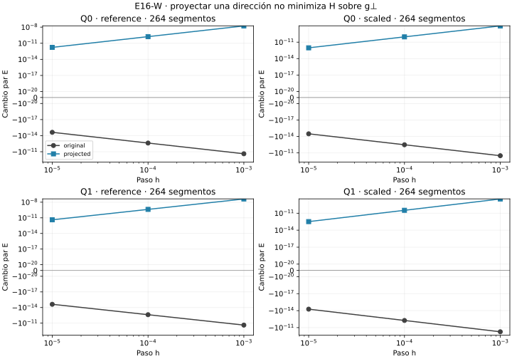

# E16-W — Variación de primer orden casi nula

Estado **EXPLORATORY**, diagnóstico **PASS**: doce caminos, 144 ensayos,
140 válidos, cuatro inviables conservados y ninguno inválido. Pasan las
1.144 comprobaciones. Mínimos permanecen UNKNOWN.

La dirección mínima original se proyecta sobre el plano perpendicular al
gradiente MP archivado y se normaliza en MP. En los ocho cuadráticos, la
pendiente direccional queda numéricamente casi nula, la curvatura de esa
dirección es positiva y los dos sentidos aumentan longitud en los tres pasos.
Esto **no demuestra positividad de todo g⊥**: proyectar un autovector no
resuelve el problema de mínima curvatura en el subespacio.

- [Diseño congelado](DESIGN_FROZEN.md), [configuración y fuentes](config.json).
- [Formulación y límites](THEORY.md), [conclusión](CONCLUSION.md), [avances](progress.md).
- [Resumen](results/run_v1/summary.json), [direcciones](results/run_v1/directions.csv), [auditorías direccionales](results/run_v1/audits.csv), [todos los ensayos](results/run_v1/trials.csv), [parejas](results/run_v1/pairs.csv), [comprobaciones](results/run_v1/checks.csv) y [costes](results/run_v1/costs.csv).

## Todos los caminos

Se incluyen ambos métodos y mallas de S. Original recupera full_min de T/U;
projected usa g de las columnas MP finales de S y la proyección euclídea física
q=v−g(gᵀv)/(gᵀg), seguida de normalización y signo canónico. Los pasos son
1e-5,1e-4,1e-3, en ambos sentidos y siempre desde el mismo punto base.
No hay entrenamiento, búsqueda de otra dirección ni nuevos óptimos oficiales.

| Camino | Ruta | Curvatura MP proyectada | Pendiente MP proyectada | Válidos / 12 | Inviables |
|---|---|---:|---:|---:|---:|
| Q0/reference/132 | PROJECTED | 0.03249745 | 1.315e-27 | 12 | 0 |
| Q0/reference/264 | PROJECTED | 0.03436478 | -4.532e-28 | 12 | 0 |
| Q0/scaled/132 | PROJECTED | 0.001132467 | 2.373e-28 | 12 | 0 |
| Q0/scaled/264 | PROJECTED | 0.0185158 | -3.082e-27 | 12 | 0 |
| Q1/reference/132 | PROJECTED | 0.04363109 | 1.395e-26 | 12 | 0 |
| Q1/reference/264 | PROJECTED | 0.08380448 | -2.397e-27 | 12 | 0 |
| Q1/scaled/132 | PROJECTED | 0.000534488 | 9.55e-29 | 12 | 0 |
| Q1/scaled/264 | PROJECTED | 0.006574879 | -1.632e-28 | 12 | 0 |
| C0/reference/132 | SMALL_GRADIENT | 6.564281e-23 | 2.443e-43 | 10 | 2 |
| C0/reference/264 | SMALL_GRADIENT | 1.002364e-25 | 7.809e-49 | 12 | 0 |
| C0/scaled/132 | SMALL_GRADIENT | 6.564281e-23 | 2.443e-43 | 10 | 2 |
| C0/scaled/264 | SMALL_GRADIENT | 1.002364e-25 | 7.809e-49 | 12 | 0 |

Las curvaturas MP usan el paso direccional menor, 1e-12. Para los ocho
cuadráticos, van de 5,34e-4 a 8,38e-2. La mayor pendiente proyectada absoluta
observada en las auditorías es 1,40e-26, frente al umbral congelado 1e-18.
El coseno absoluto entre original y proyectada está entre 0,9997402 y
0,9999949 en los cuadráticos: un cambio angular pequeño puede afectar mucho
al Rayleigh si hay direcciones rígidas. No se identifica una causa única.

C0 usa SMALL_GRADIENT: norma g≤1e-25, sin dividir por ese valor pequeño.
No se afirma gradiente exactamente cero. Sus curvaturas MP casi nulas y
pequeños errores AD no se interpretan como curvatura negativa resuelta.
No aparece ninguna proyección DEGENERATE en esta corrida.

## Cambios finitos y geometría

La familia original reproduce U: 24 descensos, 26 aumentos, veinte cambios
dentro de tolerancia y dos inviables. Projected tiene cero descensos,
50 aumentos, veinte dentro de tolerancia y dos inviables. Los 48 ensayos
cuadráticos projected aumentan longitud; los cuatro controles conservan
su régimen de cambios casi nulos o aumentos. Todos los estados se archivan.

En las parejas originales hay doce E negativos, doce positivos y diez dentro
de tolerancia; projected tiene 24 E positivos y diez dentro de tolerancia.
Cada familia conserva dos parejas incompletas por inviabilidad. La banda de
signo ±1e-20 y los pasos se fijaron antes de medir.



Geometría original: 40 CHANGED, treinta UNRESOLVED y dos UNKNOWN;
projected: 48 CHANGED, 22 UNRESOLVED y dos UNKNOWN. Las cotas numéricas
heredadas de U no son intervalos rigurosos ni distancia intrínseca.
UNRESOLVED no prueba identidad de curvas. Se conservan cajas y extremos y
se comprueba positividad métrica numérica por Bernstein en cada arista válida.

## Validación y reproducción

Se contrastan pendiente y curvatura con diferencias finitas MP80/MP120,
pasos 1e-10/1e-12. Son 24 direcciones evaluadas en dos precisiones: 48 filas
de direcciones y 48 auditorías. Máximo error normalizado AD/MP de curvatura:
7,31e-13; pendiente archivada/MP: 1,40e-26. No se repite la auditoría completa
de gradiente de S ni se cambia la aceptación de S/T/U/V.

Primera corrida 135,170 s / 62,898 MiB, dentro de 900 s/512 MiB. Con las
[dependencias científicas](requirements.txt), desde la raíz:

```sh
OPENBLAS_NUM_THREADS=1 OMP_NUM_THREADS=1 python experiments/E16/W/scripts/run.py --out /tmp/e16-w
OPENBLAS_NUM_THREADS=1 OMP_NUM_THREADS=1 python experiments/E16/W/scripts/verify.py
```

**PASS_REPRODUCTION**: nueve salidas científicas idénticas byte por byte;
segunda corrida 129,791 s, dentro del presupuesto.

El verificador reconstruye identidades escalares de proyección, pendientes,
parejas, signos, geometría, costes e identidad con U; repite y compara nueve
salidas científicas byte por byte, excluyendo recursos. Figura sólo de CSV,
con [dependencias gráficas](requirements-plot.txt). No se versionan matrices,
autovectores ni polígonos intermedios.

La proyección usa gradiente archivado aproximado y la verificación es numérica;
no demuestra cero exacto, mínimo, silla exacta ni positividad del Hessiano
restringido. Son los mismos datos exploratorios, sin confirmación independiente.
S/T/U/V y todo T2-A permanecen intactos.
