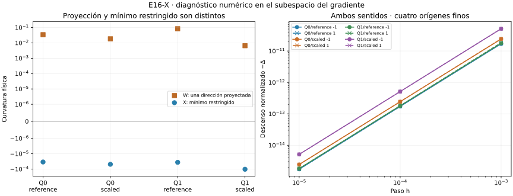

# E16-X — Mínima curvatura en el subespacio del gradiente

Estado **EXPLORATORY**, diagnóstico **PASS**: doce caminos, 72 ensayos,
70 válidos, dos inviables conservados y ninguno inválido. Pasan las 627
comprobaciones. Cuatro candidatos finos mantienen curvatura negativa dentro
de g⊥, contrastada con MP; sus nuevas direcciones descienden en ambos sentidos
para los tres pasos. Mínimos permanecen UNKNOWN.

W tenía curvatura positiva en una proyección concreta. X calcula el mínimo
numérico sobre todo el subespacio: los resultados son compatibles, porque
proyectar un autovector no equivale a minimizar el Rayleigh restringido.

- [Protocolo congelado](DESIGN_FROZEN.md), [configuración y fuentes](config.json).
- [Fórmulas y límites](THEORY.md), [conclusión](CONCLUSION.md), [avances](progress.md).
- [Resumen](results/run_v1/summary.json), [todos los espectros](results/run_v1/spectra.csv), [comparaciones con W](results/run_v1/comparisons.csv), [direcciones](results/run_v1/directions.csv), [auditorías MP](results/run_v1/audits.csv), [ensayos](results/run_v1/trials.csv), [parejas](results/run_v1/pairs.csv), [comprobaciones](results/run_v1/checks.csv) y [costes](results/run_v1/costs.csv).

## Todos los caminos

Se usan los doce originales de S sin filtrar por resultado. Una base ortonormal
B de g⊥ se obtiene por Householder; se diagonaliza Hc=BᵀHB. El mínimo vector
se levanta al espacio físico y se limpia en MP sólo el residuo float de la
restricción, comprobando que conserva Rayleigh y condición de autovector.
C0 usa SMALL_GRADIENT y espacio completo, sin quitar una dirección arbitraria.

| Camino | Ruta | μ mínimo | Umbral τ | Parejas con ambos descensos / 3 |
|---|---|---:|---:|---:|
| Q0/reference/132 | GRADIENT_RESTRICTED | 3.145415e-06 | 3.711e-06 | 0 |
| Q0/reference/264 | GRADIENT_RESTRICTED | -3.442908e-05 | 7.229e-06 | 3 |
| Q0/scaled/132 | GRADIENT_RESTRICTED | 2.595336e-06 | 3.8817e-06 | 0 |
| Q0/scaled/264 | GRADIENT_RESTRICTED | -4.862003e-05 | 7.971e-06 | 3 |
| Q1/reference/132 | GRADIENT_RESTRICTED | 2.849962e-06 | 3.8399e-06 | 0 |
| Q1/reference/264 | GRADIENT_RESTRICTED | -3.618143e-05 | 7.6806e-06 | 3 |
| Q1/scaled/132 | GRADIENT_RESTRICTED | 2.620331e-06 | 3.9455e-06 | 0 |
| Q1/scaled/264 | GRADIENT_RESTRICTED | -0.0001022753 | 8.1184e-06 | 3 |
| C0/reference/132 | SMALL_GRADIENT | -8.531995e-12 | 0.0001746 | 0 |
| C0/reference/264 | SMALL_GRADIENT | -1.358617e-11 | 0.00065605 | 0 |
| C0/scaled/132 | SMALL_GRADIENT | -8.531995e-12 | 0.0001746 | 0 |
| C0/scaled/264 | SMALL_GRADIENT | -1.358617e-11 | 0.00065605 | 0 |

Los cuatro cuadráticos de 132 tienen mínimo positivo dentro de la banda casi
nula: no se presenta como positividad exacta. En 264, μ va de −3,44e-5 a
−1,02e-4, por debajo de los umbrales de 7,23e-6 a 8,12e-6. Sus Rayleigh
MP confirman la señal. C0 conserva los modos casi nulos y sus diminutos
negativos de redondeo no son curvatura negativa resuelta.

Se archivan 9.448 autovalores escalares entre espectros completos y reducidos.
Pasan los controles de ortonormalidad, ortogonalidad, residuos y entrelazado de
Cauchy, además de tres controles analíticos de matrices 3×3. El espectro
restringido se calcula en float64; las auditorías MP verifican las direcciones
mínimas, no cada entrada ni todos los autovectores.

## Pendiente casi nula y cambios finitos

Máxima pendiente direccional absoluta MP observada: 3,35e-28, frente al umbral
congelado 1e-18. Se usan pasos direccionales 1e-10/1e-12 y MP80/MP120;
error normalizado máximo de curvatura AD/MP 7,31e-13. Las 24 filas de auditoría
corresponden a doce direcciones en dos precisiones.

Los cuatro finos tienen 24 descensos, seis por camino: ambos sentidos en
h=1e-5/1e-4/1e-3. Para h=1e-3, Δ está entre −1,69e-11 y −5,12e-11,
con cambios geométricos numéricamente detectados en esos ocho ensayos.
Los descensos son pequeños; no se selecciona un paso mejor ni se actualizan
los candidatos. Los términos impares finitos explican que ambos descensos
no sean idénticos, aun con pendiente casi nula.

En los 72 ensayos hay 24 descensos, 26 aumentos, veinte cambios dentro de
tolerancia y dos UNKNOWN por inviabilidad. Geometría: cuarenta CHANGED,
treinta UNRESOLVED y dos UNKNOWN. Las cotas euclídeas de U no son intervalos
rigurosos; no se interpreta UNRESOLVED como identidad de curvas.



## Coste y reproducción

Primera corrida: 65,357 s / 71,160 MiB, dentro de 900 s/512 MiB. Con
[requirements.txt](requirements.txt), desde la raíz:

```sh
OPENBLAS_NUM_THREADS=1 OMP_NUM_THREADS=1 python experiments/E16/X/scripts/run.py --out /tmp/e16-x
OPENBLAS_NUM_THREADS=1 OMP_NUM_THREADS=1 python experiments/E16/X/scripts/verify.py
```

**PASS_REPRODUCTION**: once salidas científicas idénticas byte por byte;
segunda corrida 64,954 s, dentro del presupuesto.

El verificador reconstruye espectros, entrelazado, umbrales, comparación con W,
parejas, signos, geometría y costes; repite para igualdad exacta de once salidas
científicas, excluyendo recursos. Figura sólo de CSV, con las
[dependencias gráficas](requirements-plot.txt). Matrices, autovectores y
polígonos intermedios no se versionan.

El subespacio depende de un gradiente aproximado; el mínimo y su umbral son
numéricos. No se certifica silla exacta, mínimo, geodésica o convergencia continua.
Los datos son los mismos exploratorios, sin confirmación independiente.
S/T/U/V/W y todo T2-A intactos. W es dependencia sin merge automático.
