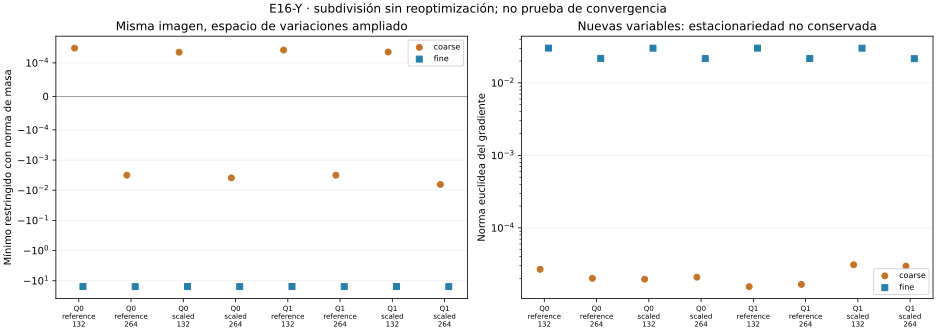

# E16-Y — Refinamiento con norma consistente

Estado **EXPLORATORY**, diagnóstico **PASS**: doce fuentes y 24 problemas de
malla; pasan las 559 comprobaciones. La subdivisión conserva imagen y longitud,
pero **no conserva la estacionariedad al añadir variables**. Los ocho refinados
cuadráticos tienen gradientes nuevos importantes y testigos MP negativos.
Esto no demuestra estabilidad de mínimos optimizados ni convergencia continua.

- [Protocolo congelado](DESIGN_FROZEN.md), [configuración y fuentes](config.json).
- [Fórmulas y alcance](THEORY.md), [conclusión](CONCLUSION.md), [avances](progress.md).
- [Resumen](results/run_v1/summary.json), [dos niveles](results/run_v1/comparisons.csv), [problemas](results/run_v1/paths.csv), [gradientes nuevos](results/run_v1/gradients.csv), [espectros](results/run_v1/spectra.csv), [auditorías MP](results/run_v1/audits.csv), [comprobaciones](results/run_v1/checks.csv) y [costes](results/run_v1/costs.csv).

## Qué cambia respecto de X

Se usan todos los caminos originales de S, sin seleccionar por outcome. Cada
poligonal coarse de 132/264 se subdivide por puntos medios exactos MP a
264/528. No se optimiza ni se cambia su imagen. Las nuevas variables incluyen
desplazamientos que antes no existían: su gradiente se calcula de nuevo por
FD locales MP80 en cada coordenada, con dos pasos y contraste AD.

Se usa una masa P1 consistente sobre longitud de arco euclídea normalizada
de cada fuente. Se resuelve min vᵀHv sujeto a vᵀMv=1 y gᵀv=0; esta norma
es compatible con el transporte entre sus dos mallas. **Los valores no son
directamente comparables con X**, que usaba norma euclídea del vector nodal.
El nivel coarse se calcula aquí con la nueva norma, sin reescribir X.

## Todos los resultados

| Fuente | μ coarse | μ fine | ‖g coarse‖₂ | ‖g fine‖₂ | Testigo MP coarse / fine |
|---|---:|---:|---:|---:|---|
| Q0/reference/132 | 0.0003081924 | -15.52456 | 2.6806e-05 | 0.030173 | False / True |
| Q0/reference/264 | -0.003163886 | -15.70883 | 2.0141e-05 | 0.021744 | True / True |
| Q0/scaled/132 | 0.0002250943 | -15.52899 | 1.9594e-05 | 0.030133 | False / True |
| Q0/scaled/264 | -0.003893394 | -15.7119 | 2.0884e-05 | 0.021637 | True / True |
| Q1/reference/132 | 0.0002660548 | -15.51721 | 1.547e-05 | 0.030162 | False / True |
| Q1/reference/264 | -0.003180545 | -15.70562 | 1.6619e-05 | 0.021693 | True / True |
| Q1/scaled/132 | 0.0002290037 | -15.52589 | 3.0978e-05 | 0.030134 | False / True |
| Q1/scaled/264 | -0.006430438 | -15.71134 | 2.9689e-05 | 0.02161 | True / True |
| C0/reference/132 | -3.354369e-08 | -3.187971e-07 | 8.1035e-37 | 3.2414e-36 | False / False |
| C0/reference/264 | -3.187971e-07 | -2.538927e-06 | 3.2414e-36 | 1.2966e-35 | False / False |
| C0/scaled/132 | -3.354369e-08 | -3.187971e-07 | 8.1035e-37 | 3.2414e-36 | False / False |
| C0/scaled/264 | -3.187971e-07 | -2.538927e-06 | 3.2414e-36 | 1.2966e-35 | False / False |

Cada pareja usa su propia poligonal de referencia. No se comparan como si
fueran la misma curva las fuentes S/132 y S/264, aunque sus imágenes sean próximas.
En los ocho refinados cuadráticos μ está entre −15,52 y −15,72. La norma
euclídea del gradiente pasa del orden 1e-5 al orden 1e-2. Esa norma depende
del número de variables; además, las mayores componentes nuevas por fuente
están entre 0,00152 y 0,00281, medidas con MP y contrastadas con AD.
Por tanto, no se trata sólo de añadir entradas nulas al vector.

La identidad Sᵀgf=gc pasa: el gradiente fino puede ser grande en direcciones
que no son transportes de variables gruesas, y aun así devolver el gradiente
grueso pequeño al restringirlo. La misma identidad de transporte pasa para
Hessianos y masa. Máximos errores observados: masa 3,47e-18, gradiente 3,64e-19
y Hessiano relativo 2,26e-13. Pasan las doce desigualdades μfine≤μcoarse
con la tolerancia congelada; no se impone ni se observa igualdad de mínimos.



## Gradientes, espectros y controles

Se archivan 9.480 componentes nuevas de gradiente, cada una con AD y dos
FD MP; 14.192 autovalores restringidos y 48 auditorías direccionales.
Hay doce testigos MP negativos: cuatro coarse cuadráticos y ocho fine.
C0 no tiene testigos negativos, pese a pequeños mínimos float negativos.
La masa y el espectro alto amplifican errores y ensanchan la banda casi nula;
no se interpretan esos pequeños negativos de C0 como inestabilidad real.

Se separan las clases espectrales (umbral relativo al máximo autovalor)
de los testigos direccionales MP (otro umbral congelado). Una dirección MP
negativa no certifica error de todo el espectro ni reetiqueta sus modos.
Máxima discrepancia de Rayleigh de masa AD/MP: 2,54e-6, dentro de 1e-5;
máxima pendiente direccional absoluta: 3,22e-26. Los pasos y umbrales no se ajustan.

**Convención de columnas:** gradient_AD_error y gradient_step_error en
paths.csv están reservados a la auditoría nueva de fine. En coarse valen cero
como marcador, no como afirmación de acuerdo exacto o nueva auditoría FD;
la comparación AD con el gradiente archivado coarse está medida en checks.csv.

## Reproducción y coste

Primera corrida: 139,893 s / 192,156 MiB, dentro de 900 s/512 MiB. Con
[requirements.txt](requirements.txt), desde la raíz:

```sh
OPENBLAS_NUM_THREADS=1 OMP_NUM_THREADS=1 python experiments/E16/Y/scripts/run.py --out /tmp/e16-y
OPENBLAS_NUM_THREADS=1 OMP_NUM_THREADS=1 python experiments/E16/Y/scripts/verify.py
```

**PASS_REPRODUCTION**: nueve salidas científicas idénticas byte por byte;
segunda corrida 142,609 s, dentro del presupuesto.

El verificador reconstruye niveles, gradientes finos, masas, espectros,
testigos, costes y fuentes; repite para comparar nueve salidas científicas
byte por byte, excluyendo recursos. Figura sólo de CSV, con
[dependencias gráficas](requirements-plot.txt). Matrices y vectores internos
fuera de Git; se guardan escalares y hashes.

No hay nuevos ensayos finitos, reoptimización o nuevos candidatos estacionarios.
Una sola subdivisión no prueba convergencia, mínimo o silla exacta. Los datos
son los mismos exploratorios; etapas previas y T2-A intactos. W/X siguen
como dependencias, sin merge automático.
