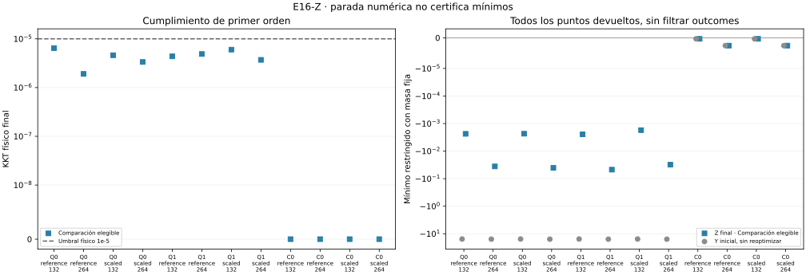

# E16-Z — Reestacionarización física antes del espectro

Estado global **PASS_PROTOCOL**. Primer orden aprobado en **12/12**,
diagnóstico espectral en **12/12** y comparación estacionaria
elegible en **12/12**. Los resultados de mínimos
permanecen UNKNOWN; pasar el protocolo no certifica un mínimo.

Se reoptimizan las doce subdivisiones de S de forma independiente, en
coordenadas físicas t/s, con una regla prospectiva de parada. No se entrenan
los pesos de la red. Las etiquetas reference/scaled son procedencias de S;
Z usa un único método L-BFGS-B físico, sin precondicionadores o reinicios nuevos.

- [Protocolo congelado](DESIGN_FROZEN.md), [configuración y fuentes](config.json).
- [Fórmulas y alcance](THEORY.md), [conclusión](CONCLUSION.md), [avances](progress.md).
- [Resumen](results/run_v1/summary.json), [caminos](results/run_v1/paths.csv), [monitor](results/run_v1/monitor.csv), [vértices finales](results/run_v1/vertices.csv), [gradientes finales](results/run_v1/gradients.csv), [espectros](results/run_v1/spectra.csv), [auditorías direccionales](results/run_v1/audits.csv), [comparaciones con Y](results/run_v1/comparisons.csv), [costes](results/run_v1/costs.csv) y [comprobaciones](results/run_v1/checks.csv).

## Todos los casos

| Fuente | Segmentos Z | Iteraciones | KKT final | Primer orden | Espectro | μ final masa | Elegible |
|---|---:|---:|---:|---|---|---:|---|
| Q0/reference/132 | 264 | 4400 | 6.4493e-06 | PASS | PASS | -0.002361743 | True |
| Q0/reference/264 | 528 | 1200 | 1.9066e-06 | PASS | PASS | -0.03590101 | True |
| Q0/scaled/132 | 264 | 3200 | 4.6034e-06 | PASS | PASS | -0.002334308 | True |
| Q0/scaled/264 | 528 | 1000 | 3.3525e-06 | PASS | PASS | -0.04047131 | True |
| Q1/reference/132 | 264 | 3400 | 4.3814e-06 | PASS | PASS | -0.002459453 | True |
| Q1/reference/264 | 528 | 600 | 4.8866e-06 | PASS | PASS | -0.04717672 | True |
| Q1/scaled/132 | 264 | 3800 | 6.0013e-06 | PASS | PASS | -0.001733736 | True |
| Q1/scaled/264 | 528 | 1600 | 3.6992e-06 | PASS | PASS | -0.03105508 | True |
| C0/reference/132 | 264 | 0 | 2.9424e-36 | PASS | PASS | -3.187971e-07 | True |
| C0/reference/264 | 528 | 0 | 1.177e-35 | PASS | PASS | -2.538927e-06 | True |
| C0/scaled/132 | 264 | 0 | 2.9424e-36 | PASS | PASS | -3.187971e-07 | True |
| C0/scaled/264 | 528 | 0 | 1.177e-35 | PASS | PASS | -2.538927e-06 | True |

Se conservan todas las fuentes y puntos devueltos. Hay **8**
testigos direccionales MP negativos, informados sin convertirlos en mínimos
ni pruebas de silla estacionaria exacta. La comparación antes/después usa la
misma masa P1 fija por fuente de Y, sin recalcularla sobre la curva final.
No debe compararse como si todas las fuentes compartieran la misma norma.

## Regla física y estados

Cada 200 iteraciones aceptadas se calcula el residuo KKT AD físico. Si supera
2e-5, se registra SCREENED_NONSTATIONARY sin FD MP y se reinicia la racha.
Si pasa ese filtro, se evalúa gradiente MP80 con dos pasos. Tres observaciones
programadas consecutivas verificadas con KKT≤1e-5 solicitan parada en ese
punto. La inicial no cuenta; una validación final MP se hace por separado.

La interrupción del callback conserva success=False/status99 de SciPy y se
registra como PHYSICAL_SUSTAINED cuando cumple el protocolo. Una terminación
natural debe pasar también la validación física final; no se le atribuye una
racha no observada. Los límites o fallos permanecen INCONCLUSIVE.

El archivo contiene 108 observaciones de monitor, de las cuales
13 son filtros AD negativos y 95 usan MP.
Estados observados: NONSTATIONARY=44, SCREENED_NONSTATIONARY=13, STATIONARY=51.
El filtro AD no se presenta como auditoría MP independiente ni las tres muestras
como garantía de cumplimiento entre observaciones o en el futuro.

## Espectro y elegibilidad

Se calcula el mínimo generalizado del Hessiano final en g⊥ con la masa fija,
con gradiente MP final nuevo, Householder y contraste de curvatura/pediente MP.
El espectro de un punto inconcluso se conserva como diagnóstico si es evaluable.
La comparación estacionaria requiere primer orden y espectro aprobados y un
punto interior con margen>1e-8. En bordes activos no se resuelve el cono crítico
de caja; g⊥ no lo sustituye. La prueba bilateral pequeña se informa aparte.

Los signos y bandas espectrales numéricas no certifican todo el espectro por
intervalos. Se separa el testigo MP de la clasificación relativa al espectro alto.
KKT aproximado puede coexistir con curvatura negativa direccional.



## Repeticiones y alcance

Las subdivisiones de algunas fuentes S/132 ya habían alimentado casos S/264.
Coincidencias exactas de hash final con estados archivados de S:

- Q0/reference/132 → Q0/reference/264
- Q1/reference/132 → Q1/reference/264
- C0/reference/132 → C0/reference/264, C0/scaled/264
- C0/scaled/132 → C0/reference/264, C0/scaled/264

Se informan como repeticiones deterministas, no confirmación independiente.
Las coincidencias no implican igualdad de autovalores entre normas de referencia
distintas. La proyección float de la subdivisión se controla frente a la
construcción MP de Y, sin afirmar identidad bit a bit de las fuentes iniciales.

Las disminuciones de longitud y cambios espectrales son resultados exploratorios.
No se selecciona un mejor punto para reemplazar S/Y, ni se descartan estados
inconclusos. Mínimos, geodésicas y convergencia continua no están certificados.
Todas las etapas previas y T2-A permanecen intactas.

## Reproducción y presupuesto

Presupuesto nuevo de Z: 1.800 s/512 MiB por corrida, congelado antes de medir.
Primera corrida: 699.019 s / 195.812 MiB,
dentro del presupuesto. Con [requirements.txt](requirements.txt), desde la raíz:

```sh
OPENBLAS_NUM_THREADS=1 OMP_NUM_THREADS=1 python experiments/E16/Z/scripts/run.py --out /tmp/e16-z
OPENBLAS_NUM_THREADS=1 OMP_NUM_THREADS=1 python experiments/E16/Z/scripts/verify.py
```

El verificador reconstruye rachas con filtro, KKT final, hashes de puntos,
elegibilidad, espectros, costes y fuentes; repite para comparar once salidas
científicas byte por byte, excluyendo recursos. El entorno exacto queda en
[provenance.json](results/run_v1/provenance.json). Figura sólo de CSV, con
[dependencias gráficas](requirements-plot.txt). Matrices, vectores de monitor y
checkpoints internos fuera de Git; sólo se guardan finales y escalares.
